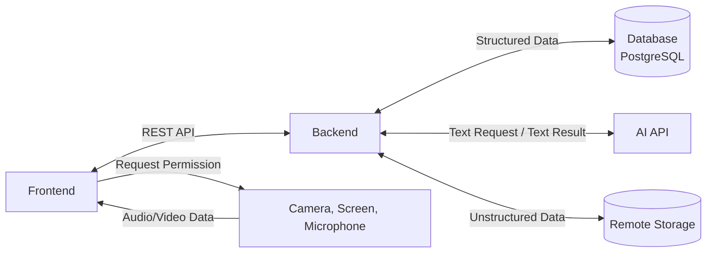
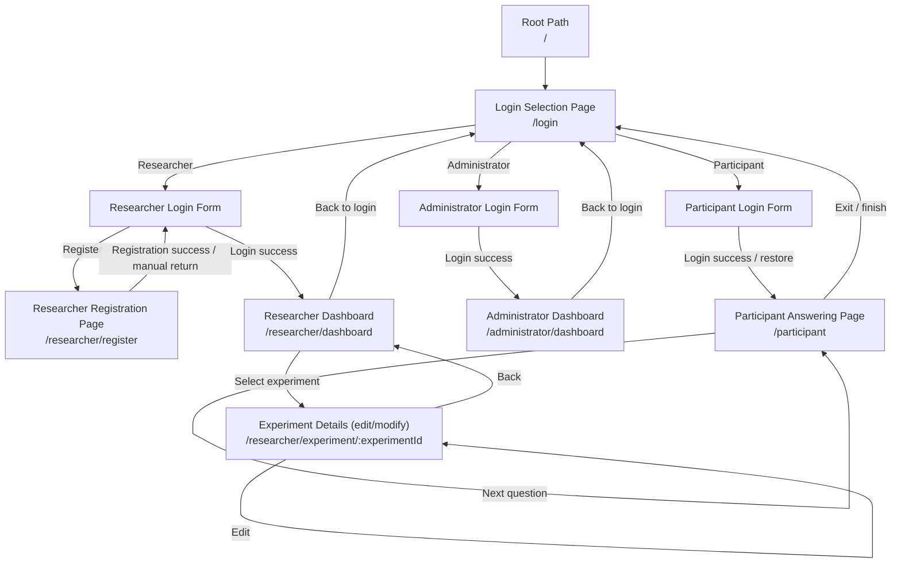
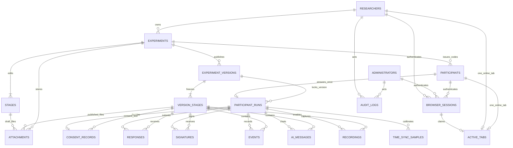

# 1. Page Layout

- Login Page
- Researcher Registration Page
- Researcher Dashboard
- Researcher Dashboard - Experiment Details (edit/modify experiment content)
- Participant Answering Page (including consent form, device permissions, various question types, welcome/farewell, etc.)
- Administrator Dashboard

# 2. Detailed Requirements / Acceptance Criteria

The style should primarily be a clean blue-and-white minimalist design, similar to Zhaopin (a recruitment website).

## 2.1 Login Page

### Frontend

- [ ] The login selection page has only one centered selection box containing three buttons: Participant, Researcher, and Administrator, each leading to the corresponding login form.
- [ ] Researcher logs in with email and password; the login form provides a registration entry point; invalid input formats are not submitted.
- [ ] Participant enters the experiment only via Experiment Code and Participant Code, without needing to register an account; invalid input formats are not submitted.
- [ ] Administrator logs in with the Admin Password; its login form does not provide other Participant or Researcher functions.
- [ ] The login state must persist; it remains active after refreshing the page.
- [ ] Abnormal login states require a popup notification, but without specifying where the error is, e.g. "Login information is abnormal".

### Backend -- Researcher

- [ ] Verify Researcher email and password.
- [ ] The password is stored only as a hash; plaintext is never stored or logged.

- [ ] On successful login, if the valid Browser Session carried by the request belongs to the same Researcher, reuse that Session and replace the active tab; otherwise revoke the Researcher's old Session and create a new persistent Browser Session.
- [ ] The Browser Session's random Token is returned to the browser via an HttpOnly Cookie; the database stores only the Token digest.
- [ ] The Browser Session Cookie persists after the browser is closed.
- [ ] Each protected request verifies that the Browser Session exists, is valid, and has not expired.

- [ ] Each tab generates an independent tab_id, stored in that tab's sessionStorage for reuse across refreshes.
- [ ] tab_id is associated with the current Browser Session.
- [ ] Only one active tab is allowed for the same Researcher at any time.
- [ ] The backend records the current active_tab_id and its owning Browser Session.

- [ ] The current active tab remains logged in after the page is refreshed.
- [ ] When a tab is closed, attempt to notify the backend to release the active tab.
- [ ] If the tab-close notification fails, the new tab must be able to identify and handle the already-nonexistent old active tab.

- [ ] When the Browser Session is valid and there is currently no active tab, a new tab may automatically restore the login.
- [ ] When the Browser Session is valid but another active tab already exists, do not automatically restore the login; instead show a message that the account is already in use in another tab, then return to /login.

- [ ] When another tab re-enters the email and password and logs in successfully, set it as the new active tab.
- [ ] Once the new tab logs in successfully, immediately invalidate the old active tab.
- [ ] Subsequent protected API requests from the old tab return 401 Unauthorized.

- [ ] When tab preemption occurs within the same Browser Session, only replace the active tab; do not revoke the Browser Session.
- [ ] When a different Browser Session logs in as the same Researcher, revoke the old Browser Session so that the old browser must re-enter the email and password on its next access.

- [ ] Retain the Browser Session after the browser is closed; the original tab is no longer considered active after the close notification succeeds or the heartbeat times out.
- [ ] When the browser is reopened, if the Browser Session is still valid and no other online tab exists, a new active tab may be created and automatically enter the Dashboard.

- [ ] When a Researcher actively performs Logout, revoke both the current Browser Session and active tab.
- [ ] After a password change, revoke all of that Researcher's Browser Sessions and active tabs.

### Backend -- Participant

- [ ] Validate Experiment Code and Participant Code as a pair.

- [ ] On successful login, if the valid Browser Session carried by the request belongs to the same Participant, reuse that Session and replace the active tab; otherwise revoke the Participant's old Session and create a new persistent Browser Session.
- [ ] The Browser Session's random Token is returned to the browser via an HttpOnly Cookie; the database stores only the Token digest.
- [ ] The Browser Session Cookie persists after the browser is closed.
- [ ] Each protected request verifies that the Browser Session exists, is valid, and has not expired.

- [ ] Each tab generates an independent tab_id, stored in that tab's sessionStorage for reuse across refreshes.
- [ ] tab_id is associated with the current Browser Session.
- [ ] Only one active tab is allowed for the same Participant at any time.
- [ ] The backend records the current active_tab_id and its owning Browser Session.

- [ ] The current active tab remains logged in after the page is refreshed.
- [ ] When a tab is closed, attempt to notify the backend to release the active tab.
- [ ] If the tab-close notification fails, the new tab must be able to identify and handle the already-nonexistent old active tab.

- [ ] When the Browser Session is valid and there is currently no active tab, a new tab may automatically restore the login.
- [ ] When the Browser Session is valid but another active tab already exists, do not automatically restore the login; instead show a message that the account is already in use in another tab, then return to /login.

- [ ] When another tab re-enters the Experiment Code and Participant Code and logs in successfully, set it as the new active tab.
- [ ] Once the new tab logs in successfully, immediately invalidate the old active tab.
- [ ] Subsequent protected API requests from the old tab return 401 Unauthorized.

- [ ] When tab preemption occurs within the same Browser Session, only replace the active tab; do not revoke the Browser Session.
- [ ] When a different Browser Session logs in as the same Participant, revoke the old Browser Session so that the old browser must re-enter the Experiment Code and Participant Code on its next access.

- [ ] Retain the Browser Session after the browser is closed; the original tab is no longer considered active after the close notification succeeds or the heartbeat times out.
- [ ] When the browser is reopened, if the Browser Session is still valid and no other online tab exists, a new active tab may be created and automatically enter the Answering Page.

- [ ] When a Participant actively performs Logout, revoke both the current Browser Session and active tab.

## 2.2 Researcher Registration Page

### Frontend

- [ ] Validate the email and password input formats; illegal input is not allowed to be submitted.
- [ ] After successful registration, return to the Researcher login form with the just-registered email pre-filled and the password left blank.
- [ ] After receiving a registration failure message from the backend, show a popup notification.

### Backend -- Researcher

- [ ] Create a Researcher account using email and password; email must be unique; password is stored as a hash.
- [ ] Case-insensitive.
- [ ] Return clear, front-end-handlable error states on registration failure, e.g. email already exists, email format invalid, password does not meet requirements.
- [ ] Error responses must not return the password, password hash, Session ID, or other internal credentials.
- [ ] After successful registration, return the Researcher's email; do not return password_hash or the plaintext password.

## 2.3 Researcher Dashboard

### Frontend

- [ ] The top navigation bar contains: on the right side, the email and a logout button are displayed.
- [ ] The Researcher's Dashboard must list all experiments owned by the currently logged-in Researcher and display:
    - Experiment name (exp_name)
    - Auto-generated Experiment Code (exp_code)
    - Experiment status (exp_status)
    - Creation date (exp_creation_date)
    - Last edited time (exp_last_editing)
- [ ] The experiment name can be modified.
- [ ] A Researcher can only see experiments they created or own, and cannot see other Researchers' experiments.
- [ ] All experiments are sorted by creation time; different sorting methods can be selected: time, name, with a reverse-order option provided.
- [ ] Experiments can be filtered by status.
- [ ] Each experiment card has four buttons: Edit, Delete, Export Results, and End Experiment; the Delete button is disabled when a Participant Run already exists.
- [ ] The Edit button navigates to the corresponding experiment detail editing page.
- [ ] Deleting an experiment requires a second confirmation popup; experiments with an existing Participant Run cannot be deleted and should be prompted that they can be ended but not deleted.
- [ ] The Export Results button first shows a popup indicating how many participants have completed the test and how many have started but not finished; the popup provides Cancel and Download CSV buttons.
- [ ] After ending the experiment, status becomes closed and Participants are not allowed to continue; existing but unfinished Runs are marked as terminated.
- [ ] A Researcher can create a new experiment.
- [ ] After clicking Create Experiment, a popup asks for the experiment name, then adds the new experiment below the existing ones.
- [ ] When creating an experiment, the system automatically generates a unique Experiment Code.
- [ ] An existing experiment can be copied as a new experiment; the copy receives a new Experiment Code, and the original experiment is unaffected.
- [ ] The Experiment Code cannot be manually modified by a Researcher.
- [ ] The Experiment Code can be copied.
- [ ] A Researcher can delete experiments.

### Backend -- Researcher

- [ ] Return only the experiments owned by the current Researcher.
- [ ] The experiment list returns exp_name, exp_code, status, exp_creation_date, exp_last_editing.
- [ ] status has three states: draft, published, closed.
- [ ] Support modifying the experiment name.
- [ ] New experiments default to: status = draft.
- [ ] Provide a single-experiment detail endpoint that verifies experiment ownership.
- [ ] Provide a create-experiment endpoint that automatically associates the current Researcher.
- [ ] When creating an experiment, the backend automatically generates a unique and non-modifiable Experiment Code.
- [ ] New experiments automatically record the creation time and set the default status.
- [ ] Provide a delete-experiment endpoint that verifies ownership before deletion; reject deletion when a Participant Run already exists.
- [ ] All experiment view, modify, and delete permissions must be verified by the backend.
- [ ] Experiment results and records can be read.

## 2.4 Researcher Dashboard - Experiment Details

### Frontend

- [ ] The top displays the experiment ID, name, and status, and provides a Publish button; a closed experiment cannot be re-published.
- [ ] The default state is edit mode.
- [ ] There is a Full-screen Mode toggle.
- [ ] There is an Allow Free Stage Selection toggle.
- [ ] There is an Allow Pause toggle.
- [ ] The page is divided into three columns: Stage list, Builder Canvas, and Stage Features.

#### Stage

- [ ] Display all Stages with their sequence number, name, and type.
- [ ] An experiment draft consists of 1-20 ordered Stages; once 20 is reached the add button is hidden; publishing requires at least a consent form and one answering Stage.
- [ ] The consent form is fixed as the first Stage by default and cannot be reordered or deleted.
- [ ] The consent Stage does not enable AI, countdown, screen recording, or copy-paste logging; it only allows consent text, signatures, and attachments for reading.
- [ ] Stages can be added, deleted, and drag-reordered.
- [ ] The current Stage is highlighted.
- [ ] A stage contains only the specified types: consent form, single-choice, multiple-choice, true/false, fill-in-the-blank, short answer, and video oral short answer.

#### Builder Canvas

- [ ] Display the content of the currently selected Stage and allow editing.
- [ ] Single-choice and multiple-choice questions can have 2-6 options.
- [ ] All question prompts are editable.
- [ ] Consent form content can be modified.
- [ ] The consent form may optionally include a signature box.

#### Stage Features

- [ ] Each Stage can be configured with features individually.
- [ ] Supported features:
    - AI Chat (toggle)
    - Countdown Timer (toggle + time input box, in minutes)
    - Screen Recording (toggle)
    - Copy-paste logging (toggle, available only for fill-in-the-blank and short-answer)
    - Signature box (toggle)
    - Attachment (toggle + file upload)
- [ ] When switching Stages, display the corresponding Feature states.
- [ ] New stages default to Countdown Timer 2min, Screen Recording on, others off.
- [ ] The AI Assistant appears only in enabled Stages, with the chat box to the right of the existing questions; an initial Prompt invisible to the Participant can be configured for that Stage. The Researcher can select the AI provider and model from a supported list, and in advanced settings customize the API and test the connection; the Participant cannot change these.
- [ ] The signature box allows the Participant to draw or type an electronic signature.
- [ ] The attachment component lets the Participant view or download attachments within a Stage; file type and size limits are configurable.

### Backend -- Researcher

- [ ] Read and save all experiment-setting-related data.
- [ ] Support reading experiment details.
- [ ] Only the Experiment owner can edit the Experiment.
- [ ] Participants are not allowed to call Researcher editing endpoints.
- [ ] Update updated_at on every Experiment modification.
- [ ] Edits to a published experiment update only the draft; after re-publishing, only new Runs use the new version, while existing Runs keep the originally published version.
- [ ] The Dashboard can query the current Researcher's own Experiments by owner_id.
- [ ] Each stage's features configuration is saved individually.
- [ ] The AI Assistant's API settings accept custom data from the frontend and provide a test-connection function.
- [ ] The AI Assistant's API settings are returned only to the current experiment owner.
- [ ] Signatures are saved by Participant Code and visible to Researchers authorized to access that experiment.
- [ ] Video answers, screen recordings, attachments, and handwritten signature files are saved externally; the database stores the corresponding links.

## 2.5 Participant Answering Page

### Frontend

- [ ] Display the page according to the experiment's Full-screen Mode setting; the Participant can only answer following the flow and cannot modify the experiment configuration.
- [ ] Each Stage must display the current time; the timer is loaded on demand.
- [ ] Load according to the corresponding Stage configuration.
- [ ] Stages are presented in the order set by the researcher.
- [ ] After consent, sequential mode answers Stages in order; free-stage-selection mode lets the participant choose the next unanswered Stage from the remaining ones. The current Stage cannot be switched before submission or timeout, and processed Stages cannot be returned to.
- [ ] When the timer is paused, stop the countdown and the Stage's activities; when resumed, restore the exact Stage state. Timer start, expiry, extension, pause, and resume must all be recorded.
- [ ] After a page refresh, crash, or re-entering the same Code, restore the exact Stage and unsubmitted input; completed or terminated Runs show the corresponding status and do not re-answer.
- [ ] Single-choice, multiple-choice, and text inputs work per component configuration; answers are associated with Participant Code, Stage, and timestamp.
- [ ] Provide a Next Stage button, but it is inactive while the current Stage is unsubmitted and not timed out; in free-stage-selection mode, after completing the current Stage, choose the next unprocessed Stage.
- [ ] After all answering Stages are submitted or timed out, show Finish; the server re-verifies that all Stages have been processed to prevent skipping.
- [ ] For Stages that enable camera, microphone, or screen recording, before recording the corresponding device or screen permission must be explicitly requested, and a re-authorize button must exist to re-request permission.
- [ ] The Participant can see the camera capture view and recording status in real time.
- [ ] An embedded text chat is shown only in Stages with AI enabled; image or file input is not accepted. Stages with AI off do not show the Assistant.
- [ ] Save the current state every 3 minutes.
- [ ] Before clicking Finish, first submit and confirm pending client events to avoid losing collected events after completing the Run.
- [ ] The page order is Code login, consent, welcome page, start answering, end page; the welcome and end pages respectively pass the Participant's start and completion information of the experiment to the backend.

### Backend -- Participant

- [ ] Before obtaining consent, do not start experiment event collection, screen recording, audio/video recording, or AI conversation logging; on refusal, end the Run and allow the Participant to view the terminal state after refusal.
- [ ] Save the accept/refuse decision, consent text version, Participant Code, and unified-clock timestamp; if a signature is required on acceptance, save it together with the decision; on refusal no signature is required; consent records are included in exports.
- [ ] Save the Participant's current Stage, submitted answers, timeout results, and unsubmitted-input recovery state; submission or timeout settlement stays consistent with Stage advancement to avoid duplicate submission or skipping.
- [ ] Automatically record Stage enter, advance, submit, pause, resume, timing, attachment operations, signature, copy-paste, and recording start/end events; copy-paste events include the specific text and timestamp and are disclosed in the consent statement.
- [ ] All events, AI messages, and media events use sub-second timestamps from the unified clock, alignable by Participant Code, Stage, and time order.
- [ ] AI requests are sent via a backend proxy, fully preserving the Participant messages and AI replies within a Stage; each message records the timestamp and the model used.
- [ ] Recording files are stored by Participant Code and Stage in approved storage locations; media references correspond to the event timeline.
- [ ] For non-video questions, if screen-recording authorization is refused or upload fails, record the failure but do not block answer submission; video oral questions must reference a completed recording, and on failure allow re-authorization or re-recording, keeping the Run available for recovery on next login if unfinished.

## 2.6 Administrator Dashboard

### Functional Requirements

- [ ] Display all registered Researchers and their corresponding experiment names and exp_code.
- [ ] Display all Participants who have joined experiments.
- [ ] Display all experiments and their statuses.
- [ ] Display the corresponding relationships.
- [ ] For Researchers, support deactivating accounts, changing passwords, and modifying experiments.
- [ ] Allow exporting any experiment data of Participants.
- [ ] Administrator edits to experiments update only the draft; the Dashboard provides a publish action, and the new version applies only to new Runs while existing Runs keep the original version.
- [ ] Further features pending refinement...

# 3. Overall Structure

## 3.1 Web System Architecture Diagram



# 4. Language / Technology

| Category | Technology / Framework |
| --- | --- |
| Frontend Language | TypeScript, HTML, CSS |
| Frontend Framework | React |
| Build Tool | Vite |
| UI Component Library | Ant Design |
| Routing | React Router |
| State Management | Zustand |
| Frontend API Requests | TanStack Query + Axios |
| Backend Language | Python |
| Backend Framework | FastAPI |
| ORM / Data Migration | SQLAlchemy + Alembic |
| Database | PostgreSQL |
| Cloud Storage | **According to client requirements** |
| AI Services | **According to client requirements** |
| Authentication | Session + HttpOnly Cookie |
| Password Hashing | Argon2id |
| Backend Testing | Pytest |
| Frontend Testing | Vitest + React Testing Library |
| End-to-End Testing | Playwright |
| Containerization | Docker |
| Version Control | Gitlab |

# 5. Routing Information

## 5.1 Page URLs

| Page | URL |
| --- | --- |
| Root Path | `/`, redirects to `/login` |
| Login Selection Page | `/login` |
| Researcher Registration Page | `/researcher/register` |
| Researcher Dashboard | `/researcher/dashboard` |
| Researcher Dashboard - Experiment Details (edit/modify experiment content) | `/researcher/experiment/:experimentId` |
| Create/Edit Experiment Page (create) | `/researcher/experiment/new` |
| Participant Answering Page | `/participant` |
| Administrator Dashboard | `/administrator/dashboard` |

- `:experimentId` denotes the ID of a specific experiment. Creating and editing an experiment share the same page.
- After Participant login, Consent, Welcome, Instructions, Pre-Questionnaires, Sensor setup & baseline, Design Task instructions, The design task, Explanation Task instructions, Explanation (AI off), Post-Questionnaires, and Finish are rendered within `/participant`; other Stages do not have independent frontend routes.

## 5.2 Page Navigation Relationships



# 6. API Communication

## 6.1 API List

In the table, `R` stands for Researcher, `P` for Participant, `A` for Administrator, and `Public` means no login required. Except for login and registration, protected requests all use the Browser Session in the HttpOnly Cookie; R/P requests additionally submit the current `tab_id`. `/api/auth/me` and `/api/auth/tab/claim` require only a valid Session, not that `tab_id` is already active; other R/P protected requests must verify the active tab.

### 6.1.1 Authentication and Sessions

| Method | API | Permission | Request Data | Success Response |
| --- | --- | --- | --- | --- |
| `GET` | `/api/auth/csrf` | Public | none | CSRF Token; sets a separate CSRF Cookie for subsequent write requests |
| `POST` | `/api/auth/researcher/register` | Public | `email`, `password` | `email` |
| `POST` | `/api/auth/researcher/login` | Public | `email`, `password`, `tab_id` | Researcher's `id`, `email`; sets Session Cookie |
| `POST` | `/api/auth/participant/login` | Public | `experiment_code`, `participant_code`, `tab_id` | `participant_id`, experiment status, answering status; for an already-closed experiment, existing Runs can only view the terminal state and cannot create a new Run or continue answering; sets Session Cookie |
| `POST` | `/api/auth/administrator/login` | Public | `admin_password` | Administrator's `id`; sets Session Cookie |
| `GET` | `/api/auth/me` | R/P/A | none | `role`, public identity info, `active_tab` status; R/P new tabs may call before claiming |
| `POST` | `/api/auth/tab/claim` | R/P | `tab_id` | `active_tab_id`; returns conflict when another online tab is occupying |
| `POST` | `/api/auth/tab/heartbeat` | R/P | `tab_id` | `last_seen_at` |
| `POST` | `/api/auth/tab/release` | R/P | `tab_id` | release result |
| `POST` | `/api/auth/logout` | R/P/A | none | logout result; clears Session Cookie |
| `PUT` | `/api/researcher/password` | R | `current_password`, `new_password` | modification result; revokes all Sessions of that Researcher |

### 6.1.2 Researcher and Experiments

| Method | API | Permission | Request Data | Success Response |
| --- | --- | --- | --- | --- |
| `GET` | `/api/experiments` | R | Query params: `status`, `sort_by`, `descending` | list of current Researcher's experiments; each contains `exp_name`, `exp_code`, `exp_status`, `exp_creation_date`, `exp_last_editing` |
| `POST` | `/api/experiments` | R | `exp_name` | new experiment ID, non-modifiable `exp_code`, `draft` status |
| `GET` | `/api/experiments/:experimentId` | R | none | experiment settings, 1-20 ordered Stages, per-Stage Features |
| `PUT` | `/api/experiments/:experimentId` | R | experiment settings, Stage list, `revision` | updated experiment and new `revision` |
| `PATCH` | `/api/experiments/:experimentId/name` | R | `exp_name` | new name, last edited time |
| `POST` | `/api/experiments/:experimentId/copy` | R | new experiment name | copy ID, new `exp_code` |
| `POST` | `/api/experiments/:experimentId/publish` | R | `revision` | `published` status, publish version number |
| `POST` | `/api/experiments/:experimentId/close` | R | none | `closed` status; unfinished Runs become `terminated` |
| `DELETE` | `/api/experiments/:experimentId` | R | none | soft-delete result; returns `409` when a Run exists, cannot delete |
| `GET` | `/api/experiments/:experimentId/participants` | R | none | Participant Code identifier, answering-status list |
| `POST` | `/api/experiments/:experimentId/participant-codes` | R | `count` | newly generated Participant Code list; on creation, the full Code is safely returned to the owner |
| `GET` | `/api/experiments/:experimentId/results/summary` | R | none | `completed_count`, `incomplete_count` of started Runs; the latter includes terminated unfinished participants |
| `GET` | `/api/experiments/:experimentId/results.csv` | R | none | the CSV file specified in section 9.3 |
| `POST` | `/api/experiments/:experimentId/stages/:stageId/attachments` | R | `multipart/form-data` file | attachment ID, name, type, size |
| `DELETE` | `/api/experiments/:experimentId/attachments/:attachmentId` | R | none | delete-binding result |
| `POST` | `/api/experiments/:experimentId/stages/:stageId/ai/test` | R | provider, model, custom connection params | `connection_ok`, publicly disclosable error info |
| `GET` | `/api/experiments/:experimentId/media/:mediaId` | R | none | permission-verified signature, recording, or attachment file stream |

### 6.1.3 Participant Answering

| Method | API | Permission | Request Data | Success Response |
| --- | --- | --- | --- | --- |
| `GET` | `/api/participant/session` | P | none | consent/welcome/answering/completed/terminated status, current Stage, free-selection remaining Stages, unsubmitted input, timer state |
| `POST` | `/api/participant/consent` | P | `decision`, `consent_text_version`, optional signature when accepting; server verifies text version matches the Run's locked version | accept/refuse result and time |
| `POST` | `/api/participant/start` | P | none; callable only after consent | `started_at`; sequential mode returns the first answering Stage, free-selection mode returns the list of unprocessed Stages |
| `PUT` | `/api/participant/progress` | P | `stage_id`, `draft_input`, `client_sequence` | `saved_at`; used for auto-save every 3 minutes and save-before-leave |
| `POST` | `/api/participant/stages/:stageId/select` | P | none | new current Stage in free-selection mode; when no Stage is currently being processed, allows selecting a remaining Stage |
| `POST` | `/api/participant/stages/:stageId/submit` | P | `answer`, optional signature/recording ID, `idempotency_key` | submitted Stage; sequential mode returns next Stage, free-selection mode returns remaining Stages |
| `POST` | `/api/participant/timer/pause` | P | `stage_id` | remaining time, paused time; available only when the experiment allows pause |
| `POST` | `/api/participant/timer/resume` | P | `stage_id` | remaining time, new deadline |
| `POST` | `/api/participant/finish` | P | `idempotency_key`; all answering Stages submitted or timed out | `completed_at`, completion status |
| `POST` | `/api/participant/events/batch` | P | array of client interaction events sorted by `client_sequence` | received sequence numbers, server receive time; server state-transition events are not written duplicates of |
| `POST` | `/api/participant/stages/:stageId/recordings` | P | `media_type` | `recording_id`, upload limits |
| `PUT` | `/api/participant/recordings/:recordingId/content` | P | binary recording data | received byte count |
| `POST` | `/api/participant/recordings/:recordingId/complete` | P | end time, size, `status=completed/failed` | recording status, media ID (on completion); unreported interrupted segments are marked failed by server timeout |
| `GET` | `/api/participant/stages/:stageId/ai-messages` | P | none | current Stage's Participant/AI text messages |
| `POST` | `/api/participant/stages/:stageId/ai-messages` | P | `content` plain text | Participant message, AI reply, model and timestamp |
| `GET` | `/api/participant/attachments/:attachmentId` | P | none | current experiment Stage's attachment file stream |
| `POST` | `/api/participant/time-sync` | P (after consent) | `client_sent_at`, `server_received_at`, `server_sent_at`, `client_received_at` | saved time-sync sample ID, offset estimate |

### 6.1.4 Administrator

| Method | API | Permission | Request Data | Success Response |
| --- | --- | --- | --- | --- |
| `GET` | `/api/admin/researchers` | A | none | Researcher, owned experiment names and `exp_code` |
| `GET` | `/api/admin/participants` | A | optional `experiment_id` | mapping of joined Participants to experiments |
| `GET` | `/api/admin/experiments` | A | optional status filter | all experiments, owner, and status |
| `GET` | `/api/admin/experiments/:experimentId` | A | none | experiment draft settings, Stage list, current published version and `revision` |
| `PATCH` | `/api/admin/researchers/:researcherId` | A | `action=disable` or new password | deactivation/password-change result; revokes the target account's Session |
| `PUT` | `/api/admin/experiments/:experimentId` | A | experiment settings, Stage list, `revision` | modification result and new `revision` |
| `POST` | `/api/admin/experiments/:experimentId/publish` | A | `revision` | new publish version number; applies only to Runs created afterward |
| `GET` | `/api/admin/experiments/:experimentId/results.csv` | A | none | the CSV file specified in section 9.3 |

### 6.1.5 Time

| Method | API | Permission | Request Data | Success Response |
| --- | --- | --- | --- | --- |
| `GET` | `/api/time` | P (after consent) | the client records `client_sent_at` before sending | `server_received_at`, `server_sent_at`; the client records `client_received_at` after receiving |

## 6.2 Basic Frontend-Backend Message Format

### 6.2.1 Common Fields

| Location | Field | Format and Rules |
| --- | --- | --- |
| URL | Path Parameters | `:experimentId`, `:stageId`, `:recordingId`, etc. are all UUIDs; Codes are not placed in URLs |
| Header | `Content-Type` | JSON requests use `application/json; charset=utf-8`; file uploads use `multipart/form-data` or binary type per endpoint |
| Header | `X-Tab-Id` | R/P protected requests required, value is the current tab's UUID; A does not use it |
| Header | `X-Request-Id` | client-generated UUID; server writes it verbatim into the response and system logs |
| Header | `X-CSRF-Token` | all write requests (including login and registration) required; frontend first calls `/api/auth/csrf`, server compares Header with the separate CSRF Cookie |
| Cookie | `browser_session` | server sets `HttpOnly; Secure; SameSite=Lax`; frontend JavaScript does not read it |
| Cookie | `csrf_token` | server sets `Secure; SameSite=Lax`; frontend can read it and put it in `X-CSRF-Token`, separate from the Browser Session Cookie |
| JSON Field Name | `snake_case` | unified across requests and responses; unknown fields are not used as authorization basis |
| Time | ISO 8601 UTC | e.g. `2026-10-03T10:15:30.123456Z`; server time is authoritative |
| Idempotency | `idempotency_key` | Stage submit, Finish, and possibly-retried write requests carry a UUID; repeated requests with the same key return the original result |

### 6.2.2 JSON Messages

| Message | Basic Structure | Rules |
| --- | --- | --- |
| Request | `{"data": { ... }}` | GET has no request body; except file uploads; fields defined per API row |
| Success Response | `{"data": { ... }, "meta": {"request_id": "uuid", "server_time": "UTC time"}}` | creation returns `201`, other successes usually `200`; `data` is `{}` when no business content |
| Failure Response | `{"error": {"code": "ERROR_CODE", "message": "displayable text", "details": {}}, "meta": {"request_id": "uuid", "server_time": "UTC time"}}` | login failure is uniformly `LOGIN_INVALID`, not indicating which of email, password, or Code is wrong; registration validation may point out fields in `details` |
| CSV Response | `text/csv; charset=utf-8` | sets `Content-Disposition: attachment; filename="experiment_results.csv"`; content per section 9.3 |
| File Response | the file's actual MIME type | only authorized users may download; errors still use the unified JSON failure message |

| HTTP Status Code | Usage Scenario |
| --- | --- |
| `200` / `201` | success / created |
| `400` / `422` | request structure error / field validation failure |
| `401` | not logged in, Session invalid, or current `tab_id` preempted |
| `403` | logged in but not authorized to access the target experiment or function |
| `404` | target resource does not exist or its existence must not be exposed to the caller |
| `409` | version conflict, another online tab already exists, or duplicate state transition |
| `410` | experiment closed, Participant cannot continue |
| `500` | server error; response does not contain internal stack, secrets, or credentials |

# 7. Database Structure

## 7.1 Tables, Relationships, and Constraints

### 7.1.1 Table List

| Domain | Table Name | Contents |
| --- | --- | --- |
| Account | `researchers` | Researcher email, password hash, and account status |
| Account | `administrators` | the unique Administrator's password hash |
| Account | `browser_sessions` | persistent Browser Session and revocation status |
| Account | `active_tabs` | Researcher/Participant's current unique online tab |
| Experiment | `experiments` | experiment name, Code, status, and global switches |
| Experiment | `stages` | the seven editable Stage drafts in the editor |
| Experiment | `experiment_versions` | immutable experiment version produced per publish |
| Experiment | `version_stages` | immutable Stage configuration in the published version |
| Experiment | `attachments` | Stage attachments and external storage location |
| Answering | `participants` | Participant Code and identity status within the experiment |
| Answering | `participant_runs` | Participant's persistent answering progress and timer state |
| Answering | `consent_records` | accept/refuse decision and text version |
| Answering | `responses` | submitted Stage answers |
| Answering | `signatures` | typed or drawn electronic signatures |
| Events & Media | `events` | operation events occurring after consent |
| Events & Media | `ai_messages` | plain-text messages between Participant and AI within a Stage |
| Events & Media | `recordings` | screen-recording, audio, and video-oral file index |
| Time | `time_sync_samples` | client/server time-sync samples |
| Audit | `audit_logs` | high-privilege modifications and exports by administrators/Researchers |

### 7.1.2 Relationship Diagram



| Relationship/Constraint | Database Constraint and Transaction Requirements |
| --- | --- |
| Researcher -> Experiment | `experiments.owner_id` is a non-null FK; all experiment access is further verified by owner or Administrator permission |
| Experiment -> Stage | a draft has 1-20 Stages, a published version 2-20; `position` is consecutively numbered from 1, position 1 must be the non-deletable `consent`; verified in a transaction at publish |
| Experiment -> Version | `UNIQUE(experiment_id, version_number)`; versions are immutable after publish; in-progress Runs fixedly use the version they entered with |
| Experiment -> Participant | `UNIQUE(experiment_id, code_lookup_digest)`; Code is validated as a pair with Experiment Code |
| Participant -> Run | `UNIQUE(participant_id)`; logging in again with the same Code restores the original Run; after completion, no redo |
| Browser Session -> active tab | each Researcher/Participant has at most one active tab at a time; login preemption, close release, and timeout reclamation are handled in a transaction |
| Run -> Response | `UNIQUE(run_id, version_stage_id)`; submission or timeout settlement, event recording, and Stage advancement complete in the same transaction |
| Run -> Event | client events use `UNIQUE(run_id, client_sequence)` for deduplication; server state-transition events do not use client sequence numbers |
| Run -> AI Message | `UNIQUE(run_id, version_stage_id, sequence)`; preserves message order within a Stage |
| Run -> Consent | `UNIQUE(run_id)`; after refusal, no new answering events, AI messages, or recordings |
| Media & Attachments | `storage_key` points to restricted external storage; the database saves the index, and experiment ownership or Participant identity is verified before reading |

## 7.2 Per-Table Field Definitions

Types follow PostgreSQL conventions: `TIMESTAMPTZ` uniformly stores UTC, `UUID` is the internal identifier, and `JSONB` structure is constrained in the corresponding rules in this section. `PK` is primary key, `FK` foreign key, `UQ` unique key, `CK` check constraint, `IX` index; fields not noted as nullable are `NOT NULL`.

### `researchers`

| Field | Type | Key/Constraint | Meaning |
| --- | --- | --- | --- |
| `id` | UUID | PK | Researcher ID |
| `email` | VARCHAR(320) | UQ; unified lowercase | login email |
| `password_hash` | TEXT | non-null | Argon2id hash, plaintext not stored |
| `status` | VARCHAR(16) | CK: `active/disabled` | account status |
| `created_at` | TIMESTAMPTZ | non-null | registration time |
| `updated_at` | TIMESTAMPTZ | non-null | last modification time |

### `administrators`

| Field | Type | Key/Constraint | Meaning |
| --- | --- | --- | --- |
| `id` | SMALLINT | PK; CK: `id = 1` | the system's unique Administrator; login does not require a username |
| `password_hash` | TEXT | non-null | Argon2id hash of the Admin Password |
| `updated_at` | TIMESTAMPTZ | non-null | password update time |

### `browser_sessions`

| Field | Type | Key/Constraint | Meaning |
| --- | --- | --- | --- |
| `id` | UUID | PK | Browser Session ID |
| `role` | VARCHAR(16) | CK: `researcher/participant/administrator` | session role |
| `researcher_id` | UUID | FK -> `researchers.id`; nullable | Researcher identity |
| `participant_id` | UUID | FK -> `participants.id`; nullable | Participant identity |
| `administrator_id` | SMALLINT | FK -> `administrators.id`; nullable | Administrator identity |
| `token_hash` | CHAR(64) | UQ | digest of the Cookie Token; raw Token not stored |
| `created_at` | TIMESTAMPTZ | non-null | creation time |
| `expires_at` | TIMESTAMPTZ | non-null | expiry time |
| `revoked_at` | TIMESTAMPTZ | nullable | revocation time from active logout, password change, or remote login |

`CK`: exactly one of the three identity FKs must be non-null and correspond to `role`. Partial unique indexes are built by identity for non-revoked Researcher and Participant Sessions respectively; when the same identity logs in with a valid Session, reuse that Session and replace the active tab; otherwise revoke the old Session first, then create a new Session in the same transaction. Expired-but-not-revoked Sessions must also be revoked first.

### `active_tabs`

| Field | Type | Key/Constraint | Meaning |
| --- | --- | --- | --- |
| `id` | UUID | PK | active tab record ID |
| `browser_session_id` | UUID | FK -> `browser_sessions.id`; UQ | owning Browser Session |
| `researcher_id` | UUID | FK -> `researchers.id`; UQ; nullable | Researcher tab |
| `participant_id` | UUID | FK -> `participants.id`; UQ; nullable | Participant tab |
| `tab_id` | UUID | non-null | browser tab-generated ID |
| `claimed_at` | TIMESTAMPTZ | non-null | claim time |
| `last_seen_at` | TIMESTAMPTZ | IX | last heartbeat time |

`CK`: exactly one of `researcher_id` and `participant_id` is non-null; Administrator does not enter this table. `UQ(researcher_id)` and `UQ(participant_id)` ensure the same identity owns at most one active tab. The Service verifies the row's identity matches the Browser Session; a release request may only release the matching current `tab_id`, and auto-claim is allowed only after timeout reclamation.

### `experiments`

| Field | Type | Key/Constraint | Meaning |
| --- | --- | --- | --- |
| `id` | UUID | PK | internal experiment ID |
| `owner_id` | UUID | FK -> `researchers.id`; IX | experiment owner |
| `exp_name` | VARCHAR(200) | non-null | experiment name, modifiable |
| `exp_code` | VARCHAR(32) | UQ | backend-generated non-modifiable Experiment Code |
| `status` | VARCHAR(16) | CK: `draft/published/closed`; IX | draft/published/closed |
| `fullscreen_mode` | BOOLEAN | default `false` | Participant full-screen mode |
| `free_stage_selection` | BOOLEAN | default `false` | whether free stage selection is allowed |
| `allow_pause` | BOOLEAN | default `false` | whether pause is allowed |
| `published_version_id` | UUID | FK -> `experiment_versions.id`; nullable | current published version |
| `revision` | INTEGER | CK: `revision >= 1` | optimistic-lock version for edits |
| `created_at` | TIMESTAMPTZ | non-null | creation time |
| `updated_at` | TIMESTAMPTZ | non-null | last edited time |
| `deleted_at` | TIMESTAMPTZ | nullable | soft-delete time when no Run exists |

`published_version_id` must belong to this experiment; the DB migration adds this FK after creating `experiment_versions`. Only `published` experiments may create new Runs; `closed` experiments reject new Runs and continued answering of existing Runs, and existing Runs may only view the terminal state and cannot be re-published. Experiments with existing Runs cannot be deleted; when no Run exists, soft-delete and invalidate issued Codes; the normal list does not return experiments with non-null `deleted_at`.

### `stages`

| Field | Type | Key/Constraint | Meaning |
| --- | --- | --- | --- |
| `id` | UUID | PK | editable Stage ID |
| `experiment_id` | UUID | FK -> `experiments.id`; IX | owning experiment |
| `position` | SMALLINT | UQ(`experiment_id`, `position`); CK: 1-20 | order in the editor |
| `type` | VARCHAR(32) | CK: seven Stage types | question type or consent form |
| `title` | VARCHAR(200) | non-null | Stage name |
| `content` | JSONB | non-null | type-specific content such as consent text, question prompt, 2-6 options |
| `features` | JSONB | non-null | AI, timer, screen recording, copy-paste, signature, attachment and attachment limits |
| `ai_config` | JSONB | nullable | provider, model, hidden initial Prompt, encrypted API Key, custom connection settings |
| `created_at` | TIMESTAMPTZ | non-null | creation time |
| `updated_at` | TIMESTAMPTZ | non-null | last modification time |

`type` may only be `consent`, `single_choice`, `multiple_choice`, `true_false`, `fill_blank`, `short_answer`, `video_oral_answer`. `CK` ensures consent iff `position = 1`; publish validation ensures exactly 2-20 consecutive Stages. Option count 2-6, copy-paste only for fill-in-the-blank/short-answer, attachment type and size, and timer minutes are validated by Schema and Service; consent Stages do not allow AI, timer, screen recording, or copy-paste logging. New question Stages default to a 2-minute countdown with screen recording on and other Features off; real collection is forbidden before consent.

### `experiment_versions`

| Field | Type | Key/Constraint | Meaning |
| --- | --- | --- | --- |
| `id` | UUID | PK | published version ID |
| `experiment_id` | UUID | FK -> `experiments.id`; IX | owning experiment |
| `version_number` | INTEGER | UQ(`experiment_id`, `version_number`); CK: `> 0` | internally increasing version number |
| `fullscreen_mode` | BOOLEAN | non-null | full-screen config at publish |
| `free_stage_selection` | BOOLEAN | non-null | free stage selection config at publish |
| `allow_pause` | BOOLEAN | non-null | pause config at publish |
| `published_at` | TIMESTAMPTZ | non-null | publish time |

Published versions cannot be updated or physically deleted after creation; in-progress Runs always reference the version they entered with.

### `version_stages`

| Field | Type | Key/Constraint | Meaning |
| --- | --- | --- | --- |
| `id` | UUID | PK | published-version Stage ID |
| `experiment_version_id` | UUID | FK -> `experiment_versions.id`; IX | owning published version |
| `position` | SMALLINT | UQ(`experiment_version_id`, `position`); CK: 1-20 | order at publish |
| `type` | VARCHAR(32) | CK: same seven types as `stages.type` | Stage type |
| `title` | VARCHAR(200) | non-null | title at publish |
| `content` | JSONB | non-null | question or consent text at publish |
| `features` | JSONB | non-null | per-Stage feature config at publish |
| `ai_config` | JSONB | nullable | model settings and encrypted credentials at publish; must not enter Participant responses |

`CK` ensures consent iff `position = 1`. This table is immutable; Participant answers, events, and media all reference this table's IDs to avoid editing drafts changing in-progress answering.

### `attachments`

| Field | Type | Key/Constraint | Meaning |
| --- | --- | --- | --- |
| `id` | UUID | PK | attachment ID |
| `experiment_id` | UUID | FK -> `experiments.id`; IX | owning experiment |
| `stage_id` | UUID | FK -> `stages.id`; nullable | draft Stage binding |
| `version_stage_id` | UUID | FK -> `version_stages.id`; nullable | published-version Stage binding |
| `storage_key` | TEXT | non-null | approved external storage object key |
| `original_name` | VARCHAR(255) | non-null | original file name |
| `mime_type` | VARCHAR(128) | non-null | file type |
| `size_bytes` | BIGINT | CK: `> 0` | file size |
| `created_at` | TIMESTAMPTZ | non-null | upload or publish-binding time |

`CK`: exactly one of `stage_id` and `version_stage_id` is non-null. At publish, a new binding is created for the version Stage; the same `storage_key` is cleaned up only after all bindings are removed. Type, size, and ownership are re-verified on upload and read.

### `participants`

| Field | Type | Key/Constraint | Meaning |
| --- | --- | --- | --- |
| `id` | UUID | PK | internal Participant ID |
| `experiment_id` | UUID | FK -> `experiments.id`; IX | corresponding experiment |
| `code_lookup_digest` | CHAR(64) | UQ(`experiment_id`, `code_lookup_digest`) | Code lookup digest computed with server secret |
| `encrypted_code` | BYTEA | non-null | encrypted Participant Code, for authorized export |
| `status` | VARCHAR(16) | CK: `active/disabled` | whether Code can be used to log in |
| `created_at` | TIMESTAMPTZ | non-null | Code generation time |

The Participant Code is not stored in plaintext; `experiment_id` + `code_lookup_digest` is used for paired validation, and the full Code is decrypted only when generating a response or authorized export.

### `participant_runs`

| Field | Type | Key/Constraint | Meaning |
| --- | --- | --- | --- |
| `id` | UUID | PK | persistent answering record ID; differs from Browser Session |
| `participant_id` | UUID | FK -> `participants.id`; UQ | each Code answers only once |
| `experiment_version_id` | UUID | FK -> `experiment_versions.id`; IX | locked published version for answering |
| `status` | VARCHAR(20) | CK: `not_started/in_progress/completed/refused/terminated` | answering status; `terminated` means interrupted by experiment closure |
| `current_version_stage_id` | UUID | FK -> `version_stages.id`; nullable | current Stage |
| `draft_input` | JSONB | non-null; default `{}` | unsubmitted input recovery data |
| `timer_state` | JSONB | non-null; default `{}` | countdown, pause, resume, and deadline |
| `created_at` | TIMESTAMPTZ | non-null | first Run creation time |
| `started_at` | TIMESTAMPTZ | nullable | welcome-page confirmation start time |
| `completed_at` | TIMESTAMPTZ | nullable | Finish, refusal, or experiment-termination end time |
| `last_saved_at` | TIMESTAMPTZ | nullable | auto-save time |

`current_version_stage_id` must belong to `experiment_version_id`. Sequential mode advances to the next Stage after submission or timeout; free-selection mode clears it at start and after each Stage is processed, awaiting selection of an unprocessed Stage. Submission, timeout settlement, and status advancement execute in a single transaction; when the experiment ends, unfinished Runs are set to `terminated` and new submissions are rejected.

### `consent_records`

| Field | Type | Key/Constraint | Meaning |
| --- | --- | --- | --- |
| `id` | UUID | PK | consent record ID |
| `run_id` | UUID | FK -> `participant_runs.id`; UQ | one Run has only one decision |
| `version_stage_id` | UUID | FK -> `version_stages.id` | the consent Stage at the time |
| `text_version` | VARCHAR(64) | non-null | researcher-published consent text version/summary |
| `decision` | VARCHAR(8) | CK: `accept/refuse` | accept or refuse |
| `decided_at` | TIMESTAMPTZ | non-null | server unified time |

If a signature is required, it is saved separately in `signatures`; this table associates the Participant Code via `run_id`. On refusal, the Run status is `refused`, and no subsequent experiment events may be created.

### `responses`

| Field | Type | Key/Constraint | Meaning |
| --- | --- | --- | --- |
| `id` | UUID | PK | answer ID |
| `run_id` | UUID | FK -> `participant_runs.id`; IX | owning answering record |
| `version_stage_id` | UUID | FK -> `version_stages.id` | answered Stage |
| `answer_data` | JSONB | non-null | on submit, the type-validated answer; on timeout, the unsubmitted-input snapshot; video-question submitted answers reference the completed recording ID |
| `outcome` | VARCHAR(16) | CK: `submitted/timed_out` | whether Stage was normally submitted or timed out |
| `entered_at` | TIMESTAMPTZ | non-null | server time of entering the Stage |
| `submitted_at` | TIMESTAMPTZ | non-null | submission or timeout-settlement time |
| `idempotency_key` | UUID | UQ(`run_id`, `idempotency_key`); nullable | required on client submit; null on server timeout settlement |

`UQ(run_id, version_stage_id)` prevents duplicate processing of the same Stage. Normal submission validates `answer_data` against the type Schema of the corresponding version Stage; timeout only saves the unsubmitted-input snapshot. The backend atomically judges submit or timeout by deadline; after timeout the Stage is considered processed.

### `signatures`

| Field | Type | Key/Constraint | Meaning |
| --- | --- | --- | --- |
| `id` | UUID | PK | signature ID |
| `run_id` | UUID | FK -> `participant_runs.id`; IX | corresponding Participant |
| `version_stage_id` | UUID | FK -> `version_stages.id` | corresponding Stage |
| `input_type` | VARCHAR(8) | CK: `typed/drawn` | typed or drawn |
| `typed_value` | TEXT | nullable | typed-signature text |
| `storage_key` | TEXT | nullable | external storage key for drawn signature |
| `signed_at` | TIMESTAMPTZ | non-null | server signature time |

`UQ(run_id, version_stage_id)`; `CK`: `typed` has only `typed_value`, `drawn` has only `storage_key`. The consent Stage's signature is saved in the same transaction only with the accept decision; refusal does not require or save a signature, and no experiment events or recordings may be produced before consent.

### `events`

| Field | Type | Key/Constraint | Meaning |
| --- | --- | --- | --- |
| `id` | UUID | PK | event ID |
| `run_id` | UUID | FK -> `participant_runs.id`; IX | owning answering record |
| `version_stage_id` | UUID | FK -> `version_stages.id`; nullable | owning Stage; experiment-level events may be null |
| `event_type` | VARCHAR(48) | IX | enter, submit, switch, pause, timing, copy-paste, etc. |
| `origin` | VARCHAR(8) | CK: `client/server` | client interaction event or server state-transition event |
| `payload` | JSONB | non-null; default `{}` | event details; copy-paste records the specific text |
| `client_time` | TIMESTAMPTZ | nullable | browser capture time of client event |
| `client_sequence` | BIGINT | UQ(`run_id`, `client_sequence`); nullable; non-null CK: `> 0` | incrementing sequence number of client event within the Run |
| `server_time` | TIMESTAMPTZ | IX | backend unified authoritative time |
| `time_sync_sample_id` | UUID | FK -> `time_sync_samples.id`; nullable | corresponding time-sync sample |

`CK`: when `origin=client`, `client_time` and `client_sequence` are required; when `origin=server`, both are null. Client batch events are accepted only for Runs that have consented and not ended; server state transitions are written by the corresponding business transaction, not via the batch interface. The refusal decision is saved in `consent_records`, not in `events`. `payload` must not contain passwords, full Code, Cookies, AI Keys, or storage keys.

### `ai_messages`

| Field | Type | Key/Constraint | Meaning |
| --- | --- | --- | --- |
| `id` | UUID | PK | message ID |
| `run_id` | UUID | FK -> `participant_runs.id`; IX | owning answering record |
| `version_stage_id` | UUID | FK -> `version_stages.id` | AI-enabled Stage |
| `role` | VARCHAR(16) | CK: `participant/assistant` | message sender |
| `content` | TEXT | non-null | plain-text message |
| `provider` | VARCHAR(80) | non-null | AI provider |
| `model` | VARCHAR(120) | non-null | actually used model |
| `sequence` | INTEGER | UQ(`run_id`, `version_stage_id`, `sequence`) | order within Stage |
| `server_time` | TIMESTAMPTZ | non-null | backend unified time |

The hidden initial Prompt and API Key are not written into Participant messages and are not returned to the Participant.

### `recordings`

| Field | Type | Key/Constraint | Meaning |
| --- | --- | --- | --- |
| `id` | UUID | PK | recording ID |
| `run_id` | UUID | FK -> `participant_runs.id`; IX | owning Participant |
| `version_stage_id` | UUID | FK -> `version_stages.id` | owning Stage |
| `media_type` | VARCHAR(16) | CK: `screen/audio/video` | screen recording, audio, or video oral |
| `status` | VARCHAR(16) | CK: `started/uploading/completed/failed` | recording and upload status |
| `storage_key` | TEXT | nullable | restricted storage key written after upload completes |
| `size_bytes` | BIGINT | nullable; CK: `>= 0` | file size |
| `started_at` | TIMESTAMPTZ | non-null | server start time |
| `ended_at` | TIMESTAMPTZ | nullable | server end time |

Only `completed` status with the storage object confirmed existing is allowed as a valid reference for video-oral answers; the media file itself is not stored in PostgreSQL. Before recording, check consent, Stage Feature, and device-permission results. The same Stage may have multiple recording segments; on pause or page interruption the current segment ends, and after resume re-authorization starts a new segment; video answers reference only completed segments. Non-video screen-recording failures do not block answering.

### `time_sync_samples`

| Field | Type | Key/Constraint | Meaning |
| --- | --- | --- | --- |
| `id` | UUID | PK | time-sync sample ID |
| `run_id` | UUID | FK -> `participant_runs.id`; IX | corresponding answering record |
| `client_sent_at` | TIMESTAMPTZ | non-null | client time of sending `/api/time` |
| `server_received_at` | TIMESTAMPTZ | non-null | server receive time |
| `server_sent_at` | TIMESTAMPTZ | non-null | server response-send time |
| `client_received_at` | TIMESTAMPTZ | non-null | client time of receiving response |
| `offset_us` | BIGINT | non-null | estimated client-to-server offset, microseconds |
| `round_trip_us` | BIGINT | CK: `>= 0` | round-trip delay estimate, microseconds |
| `quality` | VARCHAR(16) | CK: `normal/low_confidence` | sample confidence marked by delay and clock anomaly |
| `created_at` | TIMESTAMPTZ | non-null | sample ingestion time |

The original four time points cannot be overwritten; the offset estimate only aids timeline analysis and cannot replace the server's original time.

### `audit_logs`

| Field | Type | Key/Constraint | Meaning |
| --- | --- | --- | --- |
| `id` | UUID | PK | audit record ID |
| `actor_researcher_id` | UUID | FK -> `researchers.id`; nullable | Researcher actor |
| `actor_administrator_id` | SMALLINT | FK -> `administrators.id`; nullable | Administrator actor |
| `action` | VARCHAR(64) | IX | modify, publish, close, delete, change password, export, etc. |
| `target_type` | VARCHAR(32) | non-null | operated resource type |
| `target_id` | UUID | non-null | operated resource ID |
| `request_id` | UUID | IX | corresponding API request |
| `metadata` | JSONB | non-null; default `{}` | change summary without credentials |
| `created_at` | TIMESTAMPTZ | non-null | server unified time |

`CK`: exactly one of the two actor FKs is non-null. Audit records are append-only and not modified or deleted via normal business interfaces.

# 8. File Structure and Sole Owners

## 8.1 Division of Responsibilities

| Tag | Sole Owner | Scope |
| --- | --- | --- |
| `[Frontend]` | Frontend member | React pages, components, state, frontend API client, and frontend build config |
| `[Backend-Researcher]` | Researcher backend member | common backend infrastructure, Researcher, experiment edit/publish |
| `[Backend-Participant]` | Participant backend member | Participant answering, events, media, AI proxy, CSV export |
| `[Testing]` | Testing member | automated tests, test config, CI, and project run instructions |

In the list below, assigned files are tagged with only one owner; the owner field for Administrator backend files is left blank for now. A directory itself does not count as a file. Cross-module requirements are handled by the file owner modifying their file; other members raise requirements via interfaces and review. Dependency directories, caches, build artifacts, database files, and the run logs in Chapter 9 are not version-controlled.

## 8.2 Target File List

The following uses `project/project/` as the project root. The current repository does not yet contain all target files; the list represents the post-implementation structure and ownership, not that these files already exist.

```text
project/project/
├── README.md                                  # [Testing] environment preparation, run, testing, and export instructions
├── .gitignore                                 # [Testing] exclude logs, secrets, caches, and build artifacts
├── .gitlab-ci.yml                             # [Testing] frontend, backend, and end-to-end test pipeline
├── .env.example                               # [Backend-Researcher] env variable names and placeholder examples
├── docker-compose.yml                         # [Backend-Researcher] frontend, backend, PostgreSQL, and log volumes
│
├── frontend/
│   ├── index.html                             # [Frontend] Vite HTML entry
│   ├── package.json                           # [Frontend] frontend dependencies and run scripts
│   ├── package-lock.json                      # [Frontend] frontend dependency lock file
│   ├── playwright.config.ts                   # [Testing] Playwright browser and service config
│   ├── tsconfig.json                          # [Frontend] TypeScript compile config
│   ├── vite.config.ts                         # [Frontend] Vite build and dev proxy
│   ├── src/
│   │   ├── main.tsx                           # [Frontend] React mount entry
│   │   ├── App.tsx                            # [Frontend] page routing and permission boundary
│   │   ├── styles.css                         # [Frontend] blue-white theme and global styles
│   │   ├── types.ts                           # [Frontend] shared types for API and pages
│   │   ├── api/
│   │   │   ├── http.ts                        # [Frontend] Axios, Cookie, tab_id, and unified error handling
│   │   │   ├── auth.ts                        # [Frontend] registration, login, session, and logout requests
│   │   │   ├── experiments.ts                 # [Frontend] experiment edit, publish, attachment, and export requests
│   │   │   ├── participant.ts                 # [Frontend] answering, events, media, AI, and time-sync requests
│   │   │   └── administrator.ts               # [Frontend] administrator query and modify requests
│   │   ├── auth/
│   │   │   ├── sessionStore.ts                # [Frontend] Zustand login state and refresh recovery
│   │   │   └── tabIdentity.ts                 # [Frontend] per-tab tab_id, heartbeat, and release
│   │   ├── pages/
│   │   │   ├── LoginPage.tsx                  # [Frontend] three-role centered selection box and login forms
│   │   │   ├── ResearcherRegisterPage.tsx     # [Frontend] registration and return to login form
│   │   │   ├── ResearcherDashboardPage.tsx    # [Frontend] experiment list, filter, sort, and operations
│   │   │   ├── ExperimentEditorPage.tsx       # [Frontend] experiment-detail three-column editor
│   │   │   ├── ParticipantPage.tsx            # [Frontend] consent, welcome, answering, and end states
│   │   │   └── AdministratorPage.tsx          # [Frontend] accounts, experiments, and Participant relationships
│   │   ├── researcher/
│   │   │   ├── StageBuilder.tsx               # [Frontend] add/delete/reorder of 1-20 Stages
│   │   │   ├── StageContentEditor.tsx         # [Frontend] content editing and validation for seven Stage types
│   │   │   ├── StageFeatureEditor.tsx         # [Frontend] per-Stage features, attachments, and AI settings
│   │   │   └── ExportDialog.tsx               # [Frontend] completed/unfinished counts and CSV download
│   │   └── participant/
│   │       ├── StageRenderer.tsx              # [Frontend] seven Stage types, current time, and answer forms
│   │       ├── ConsentView.tsx                # [Frontend] consent decision and signature
│   │       ├── ProgressStore.ts               # [Frontend] unsubmitted input, 3-minute save, and recovery
│   │       ├── TimerController.ts             # [Frontend] display and pause/resume of server timer state
│   │       ├── EventQueue.ts                  # [Frontend] post-consent event sequence, batch send, and retry
│   │       ├── RecordingController.ts         # [Frontend] device authorization, preview, recording, and upload
│   │       └── AIChat.tsx                     # [Frontend] in-Stage plain-text AI chat
│   └── tests/
│       ├── auth.test.tsx                      # [Testing] login, registration, session recovery, and tab hints
│       ├── stage-builder.test.tsx             # [Testing] Stage type, order, and Feature validation
│       ├── participant.test.tsx               # [Testing] consent, answering, pause, and resume interaction
│       └── end-to-end.spec.ts                 # [Testing] Playwright login-to-complete and export flow
│
└── backend/
    ├── Dockerfile                             # [Backend-Researcher] FastAPI container build
    ├── requirements.txt                       # [Backend-Researcher] Python common dependency versions
    ├── alembic.ini                            # [Backend-Researcher] DB migration config
    ├── app/
    │   ├── main.py                            # [Backend-Researcher] FastAPI app and router registration
    │   ├── core/
    │   │   ├── config.py                      # [Backend-Researcher] env vars and security config
    │   │   ├── database.py                    # [Backend-Researcher] SQLAlchemy DB connection
    │   │   ├── clock.py                       # [Backend-Researcher] sole authoritative server-time interface
    │   │   ├── models.py                      # [Backend-Researcher] Browser Session and active tab models
    │   │   ├── security.py                    # [Backend-Researcher] Argon2id, Cookie Session, and active tab
    │   │   ├── routes.py                      # [Backend-Researcher] session, tab, and time APIs
    │   │   ├── logging.py                     # [Backend-Researcher] JSONL system/security/audit log writing
    │   │   ├── storage.py                     # [Backend-Researcher] external storage adapter and restricted-read interface
    │   │   └── schemas.py                     # [Backend-Researcher] unified request/response and error Schema
    │   ├── researcher/
    │   │   ├── models.py                      # [Backend-Researcher] Researcher, Experiment, Stage, and version models
    │   │   ├── schemas.py                     # [Backend-Researcher] experiment and Stage validation Schema
    │   │   ├── repository.py                  # [Backend-Researcher] owner, experiment, and version data access
    │   │   ├── service.py                     # [Backend-Researcher] registration, experiment CRUD, copy, publish, and close
    │   │   ├── attachments.py                 # [Backend-Researcher] Stage attachments and storage binding
    │   │   ├── ai_config.py                   # [Backend-Researcher] AI model config, keys, and connection test
    │   │   └── routes.py                      # [Backend-Researcher] Researcher identity and experiment API
    │   ├── administrator/
    │   │   ├── models.py                      # [ ] Administrator credentials and audit models
    │   │   ├── service.py                     # [ ] account, experiment management, and export authorization
    │   │   └── routes.py                      # [ ] Administrator login and management API
    │   └── participant/
    │       ├── models.py                      # [Backend-Participant] Code, Run, answer, event, and media models
    │       ├── schemas.py                     # [Backend-Participant] answering, consent, event, and media Schema
    │       ├── repository.py                  # [Backend-Participant] Participant data access and recovery
    │       ├── service.py                     # [Backend-Participant] Code login, Stage advancement, and timer transaction
    │       ├── routes.py                      # [Backend-Participant] Participant login and answering API
    │       ├── consent.py                     # [Backend-Participant] consent record and collection switches
    │       ├── events.py                      # [Backend-Participant] event deduplication, timeline, and batch receive
    │       ├── recording.py                   # [Backend-Participant] recording upload, status, and media index
    │       ├── ai_proxy.py                    # [Backend-Participant] AI request proxy and message saving
    │       ├── time_sync.py                   # [Backend-Participant] time-sync sample saving and offset estimate
    │       └── export_csv.py                  # [Backend-Participant] single-file CSV export per section 9.3
    ├── migrations/
    │   ├── env.py                             # [Backend-Researcher] Alembic model registration entry
    │   └── versions/
    │       ├── 0001_researcher_schema.py      # [Backend-Researcher] Researcher account, experiment, and version tables
    │       ├── 0002_participant_schema.py      # [Backend-Participant] Participant, answering, event, and media tables
    │       └── 0003_administrator_schema.py   # [ ] Administrator credentials and audit tables
    └── tests/
        ├── conftest.py                        # [Testing] DB, Session, and API test fixtures
        ├── test_auth.py                       # [Testing] login, preemption, recovery, logout, and password change
        ├── test_experiments.py                # [Testing] ownership, Stage validation, publish, and version
        ├── test_participant.py                # [Testing] consent, answering, timing, refresh, and idempotency
        ├── test_events_media_ai.py            # [Testing] event timeline, recording, and AI conversation
        └── test_admin_export.py               # [Testing] admin permissions and CSV field content
```

# 9. Logs and CSV Export

## 9.1 Log Format and Location

| Log Category | Storage Location | Format | Main Fields/Content | Write Owner |
| --- | --- | --- | --- | --- |
| Application Log | dev env `project/project/backend/logs/app.jsonl`; in container `/app/logs/app.jsonl` | one UTF-8 JSON object per line (JSONL) | `timestamp_utc`, `level`, `request_id`, `role`, `route`, `status_code`, `duration_ms`, `error_code` | backend-Researcher `core/logging.py` |
| Security Log | `project/project/backend/logs/security.jsonl`; in container `/app/logs/security.jsonl` | JSONL | `timestamp_utc`, `request_id`, `role`, `action`, `outcome`, internal user ID or anonymous identifier; no input credentials | backend-Researcher `core/logging.py` |
| Admin Audit Log | PostgreSQL `audit_logs`; after commit output to `project/project/backend/logs/audit.jsonl` | DB structure see 7.2; file is JSONL; backfill missed rows by audit ID | `actor`, `action`, `target`, `request_id`, `timestamp_utc`, desensitized change summary | backend-Researcher `core/logging.py` |
| Participant Experiment Events | PostgreSQL `events` | one row per event; `payload` is JSONB | `run_id`, `version_stage_id`, `event_type`, `origin`, `payload`, `server_time`; client events also have `client_time`, `client_sequence` | backend-Participant `events.py` |
| AI Conversation | PostgreSQL `ai_messages` | one row per message | Stage, sender, plain text, provider, model, sequence, server time | backend-Participant `ai_proxy.py` |
| Recording Index | PostgreSQL `recordings`; file body in client-approved external storage | one row per recording; file saved per restricted-storage rules | Stage, media type, start/end time, status, storage key | backend-Participant `recording.py` |
| Time-Sync Record | PostgreSQL `time_sync_samples` | one row per time-sync | four original time points, offset estimate, round-trip delay | backend-Participant `time_sync.py` |

The common format of JSONL files is as follows; absent optional fields are omitted, not written as null placeholders. `backend/logs/` is persisted via a Docker volume and not committed to GitLab.

```json
{"timestamp_utc":"2026-10-03T10:15:30.123456Z","level":"INFO","request_id":"8e72526e-8ea9-49d6-81d0-aaf46118edcb","role":"researcher","route":"POST /api/experiments","status_code":201,"duration_ms":42}
```

Passwords, full Participant Code, Browser Session Cookie, AI API Key, custom API credentials, external storage keys, and signature/media content must not enter application, security, or audit JSONL. Copy-paste specific text enters only the `events.payload` of a consented Run and is disclosed in the consent text.

## 9.2 Log Output Timing

| Timing/Action | Log or Record Produced | Write Time and Conditions |
| --- | --- | --- |
| Registration, login success or failure | Security log; successful login also creates `browser_sessions`/`active_tabs` | written immediately after backend verification; failures log only a generic error category |
| Session recovery, tab claim/preempt/release/timeout, logout, and password change | Security log | written after the state transition commits; the old tab's subsequent `401` is written to the application log |
| API request completed or exception | Application log | status code and duration written before response is sent; answers or credentials in the request body are not recorded |
| Create, modify, copy, publish, close, or delete experiment | `audit_logs` and audit JSONL | `audit_logs` and the business modification are written in the same DB transaction; after commit, JSONL is output by audit ID; on failure or process interruption, backfill from the DB |
| Administrator deactivates Researcher, changes password or experiment | `audit_logs` and audit JSONL | admin operation, account Session revocation, and `audit_logs` are written in the same DB transaction; JSONL output after commit |
| Participant submits accept or refuse | `consent_records` | written immediately upon receiving the decision; Run ends after refusal; no experiment events written at this point |
| Welcome page confirms start | `participant_runs.started_at`; after consent write `start` event | written when backend confirms start |
| Enter/switch/submit Stage, final Finish | `events`; answers also written to `responses` | server-confirmed state transitions are written as `origin=server` events in the business transaction; the client batch interface only reports other interaction events, and pending upload events must be confirmed stored before Finish |
| Auto-save every 3 minutes, save before refresh | `participant_runs.draft_input` and `last_saved_at` | time updated after successful save; no separate application log per input |
| Timer start, expiry, extension due to pause, pause, and resume | `events` and `participant_runs.timer_state` | written when backend confirms the corresponding state transition; on expiry also write `timed_out` Response and advance Stage; no answering activity for that Stage during pause |
| Attachment view/download, signature, copy-paste | `events`; signature also written to `signatures` | written only after consent; copy-paste includes action, text, and time |
| AI message sent and replied | `ai_messages`; may associate `events` | Participant message stored and AI reply arrival each written, recording the actual model |
| Screen recording, audio, video oral start/end/failure | `recordings` and `events` | start after device permission and consent; marked `completed` only after upload completes |
| Time-sync request completed | `time_sync_samples` | written after collecting all four client/server time points, without rewriting existing event times |
| Researcher or Administrator downloads CSV | `audit_logs` and audit JSONL | writes operator, experiment ID, and request ID when auth succeeds and file sending begins |

## 9.3 CSV Format and Content

The Download CSV returns a single `experiment_results.csv` using UTF-8 with BOM, comma-separated, CRLF line breaks, and a fixed first-row header; commas, quotes, or newlines in fields are escaped per CSV double-quote rules. All times are ISO 8601 UTC, missing values are empty cells; JSON fields store valid, compact JSON in one cell. Stable sort by `participant_code`, `record_time_utc`, `client_sequence`, `record_id`. Safely escape user text that spreadsheet software might interpret as a formula.

The single file uses a long-table structure: each Run, consent decision, answer, event, AI message, signature, or recording occupies one row. Each row repeats the experiment and Participant identifiers; type-specific columns that do not apply are left empty. A generated Code that never entered the experiment produces no Run row.

`record_time_utc` takes respectively the server time of Run creation, consent decision, answer submission, event server receipt, AI message, signature, or recording start; it must not be replaced by client time.

| `record_type` Value | Source per Row | When It Appears |
| --- | --- | --- |
| `run` | `participant_runs` | one row after Participant creates answering record, including status, start, and completion time |
| `consent` | `consent_records` | one row each for accept or refuse; the refuser's row is still kept |
| `answer` | `responses` | one row per submitted or timed-out Stage |
| `event` | `events` | one row per interaction event after consent |
| `ai_message` | `ai_messages` | one row per Participant or AI text message |
| `signature` | `signatures` | one row per signature |
| `recording` | `recordings` | one row per recording metadata; failed status is also kept |

| CSV Column Name | Type/Format | Content and Applicable Rows |
| --- | --- | --- |
| `experiment_code` | text | Experiment Code; all rows |
| `experiment_name` | text | experiment name; all rows |
| `experiment_version` | positive integer | published version number used by Run; all rows |
| `participant_code` | text | decrypted Participant Code on authorized export; all rows |
| `participant_status` | enum | `not_started/in_progress/completed/refused/terminated`; all rows |
| `run_id` | UUID | answering record ID; all rows |
| `record_type` | enum | the seven record types listed above; all rows |
| `record_id` | UUID | original table's primary key; all rows |
| `record_time_utc` | ISO 8601 UTC | primary occurrence time of the row; all rows |
| `stage_id` | UUID | published-version Stage ID; Stage-related rows |
| `stage_position` | 1-20 | published-version Stage order; Stage-related rows |
| `stage_type` | enum | one of seven fixed Stage types; Stage-related rows |
| `stage_title` | text | published-version Stage title; Stage-related rows |
| `run_started_at_utc` | ISO 8601 UTC | welcome-page confirmed start time; `run` rows |
| `run_completed_at_utc` | ISO 8601 UTC | completion, refusal, or experiment-termination time; `run` rows |
| `consent_decision` | `accept/refuse` | consent decision; `consent` rows |
| `consent_text_version` | text | consent version/summary; `consent` rows |
| `answer_json` | JSON string | on normal submit, type-saved answer; on timeout, unsubmitted-input snapshot; `answer` rows |
| `answer_outcome` | `submitted/timed_out` | normal submit or timeout settlement; `answer` rows, on timeout `answer_json` is the unsubmitted-input snapshot |
| `answer_entered_at_utc` | ISO 8601 UTC | time of entering the answering Stage; `answer` rows |
| `client_time_utc` | ISO 8601 UTC | browser original event time; client `event` rows only |
| `client_sequence` | positive integer | client event sequence number of the same Run; client `event` rows only |
| `event_type` | text | enter, submit, pause, timing, copy-paste, etc.; `event` rows |
| `event_payload_json` | JSON string | event details; copy-paste text exported only for consented Runs; `event` rows |
| `ai_role` | `participant/assistant` | sender; `ai_message` rows |
| `ai_content` | plain text | conversation content; `ai_message` rows |
| `ai_provider` | text | AI provider; `ai_message` rows |
| `ai_model` | text | actually used model; `ai_message` rows |
| `signature_type` | `typed/drawn` | signature method; `signature` rows |
| `signature_text` | text | typed electronic signature; `signature` rows |
| `signature_id` | UUID | controlled-view identifier for the signature record; `signature` rows, storage key not output |
| `media_type` | `screen/audio/video` | recording type; `recording` rows |
| `media_status` | text | recording/upload status; `recording` rows |
| `media_id` | UUID | controlled-download identifier; `recording` rows, storage key not output |
| `media_started_at_utc` | ISO 8601 UTC | recording start time; `recording` rows |
| `media_ended_at_utc` | ISO 8601 UTC | recording end time; `recording` rows |

CSV does not contain passwords, Cookies, AI initial Prompt, API Key, external storage keys, or public download URLs. Researchers may only download their own experiments; Administrators may download any experiment per their permission, and each export is entered into the audit log.

# 10. Clock Synchronization and Timeline

## 10.1 Time Sources

- `backend/app/core/clock.py` is the backend's sole server-time entry point. DB time uses UTC `TIMESTAMPTZ`, API and CSV use ISO 8601 strings with `Z`, retaining the microsecond field.
- The server timestamps consent decisions, state transitions, answer submissions, event receipts, AI messages, and media start/end. Client raw time is only for display and alignment analysis, not a substitute for permission checks or timer deadlines.
- Each client event in the same Run is assigned a monotonically increasing `client_sequence`. Even with network retries or out-of-order batch arrival, the original sequence number and server receive time are preserved.

## 10.2 Time-Sync Process

| Step | Action | Saved Data |
| --- | --- | --- |
| 1 | client records send time before sending `GET /api/time` | `client_sent_at` |
| 2 | server reads the unified clock on request receipt and response send | `server_received_at`, `server_sent_at` |
| 3 | client records local time after receiving response | `client_received_at` |
| 4 | client sends the four time points to `POST /api/participant/time-sync` | a `time_sync_samples` row with offset and round-trip delay estimate |

Re-time-sync after obtaining consent and starting, on page refresh, returning from background, resuming after pause, and during long answering; during normal answering sample at least once every 3 minutes, possibly together with auto-save. The server keeps every original sample and does not overwrite old ones; samples with anomalous round-trip delay are marked low confidence and not used to alter existing event times. No time-sync samples are collected before consent.

## 10.3 Countdown and Recovery

- Each timer-enabled current Stage saves `started_at`, `deadline_at`, `remaining_ms`, `paused_at`, and current status in `participant_runs.timer_state`; it is cleared after the Stage is processed and rebuilt when the next Stage first appears; subsequent Stages are not settled continuously while offline. The frontend displays the countdown from the server return value, but Stage expiry is judged by the backend. On expiry the backend atomically writes the `timed_out` Response, event, and next-Stage state; if the browser is offline, settlement happens on the first subsequent request, with the original deadline preserved in the event.
- On pause, record the remaining time and stop that Stage's submission, AI, and recording activities; on resume, the backend computes a new deadline. Moving the deadline due to pause also records a `timer_extended` event.
- After page refresh, browser reopen, or re-entering the same Code, first settle possibly-expired Stages, then restore the Run, current Stage, unsubmitted input, and server timer state. Completed, refused, or terminated Runs do not restart timing. Recording streams are not restored across refresh; interrupted segments are marked failed or completed, and a new segment starts only after re-authorization.
- After a Researcher ends the experiment, unfinished Runs, even with remaining time, become `terminated` and may not continue or submit.

## 10.4 Timeline Ordering and Acceptance

- Every event, AI message, recording, and answer is associated with `run_id`; Stage-related records also associate the published `version_stage_id`, while experiment-level events may not associate a Stage. Media records save start and end times for alignment with the event timeline.
- Research analysis uses server time as the main axis; client events additionally retain client time, event sequence number, and time-sync sample. Events with the same server time are stably sorted first by available `client_sequence`, then by record ID; server events have no client sequence.
- "Sub-second" means time fields retain sub-second precision; actual time error across devices or networks is reflected by time-sync samples, and absolute synchronization cannot be claimed solely from field precision.
- Automated tests cover clock offset, client event out-of-order and duplicate reporting, server timeout settlement, free-selection anti-skip, pause delay, refresh recovery, recording failure, media and AI timestamp alignment, Run termination after experiment end, and refusal submission.
