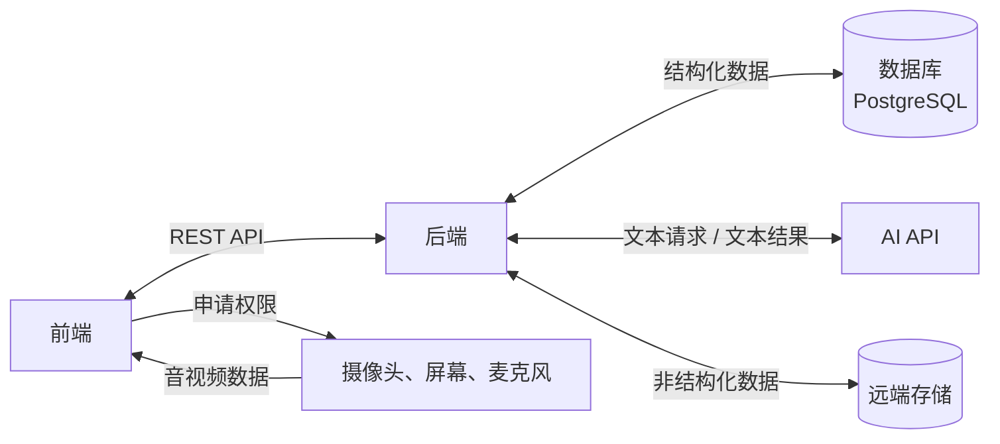
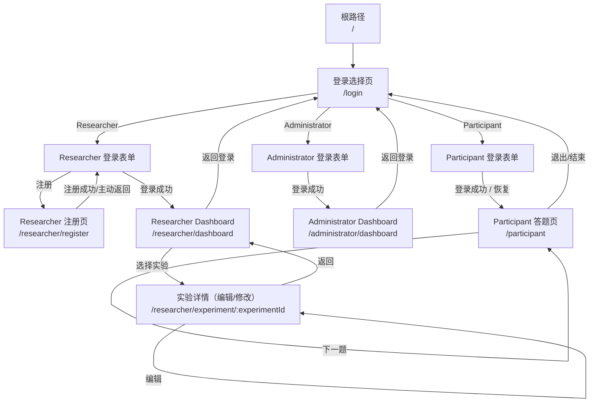
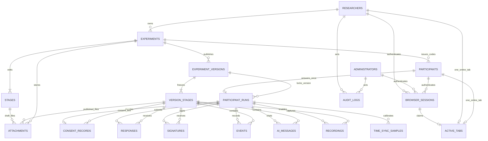

# 1. 页面安排
- 登录页
- Researcher注册页
- Researcher Dashboard
- Researcher Dashboard - 实验详情（编辑/修改实验内容）
- Participant答题页（包括知情同意书、设备权限、各种题目、欢迎/再见等）
- Administrator Dashboard

# 2. 细节要求/验收标准

风格以蓝白色简约风格为主，类似智联招聘那种

## 2.1 登录页
### 前端
- [ ] 登录选择页只有一个中心选择框，包含 Participant、Researcher 和 Administrator 三个按钮，分别进入对应的登录表单
- [ ] Researcher 使用邮箱和密码登录，登录表单提供注册入口；输入格式不合法时不提交
- [ ] Participant 只通过 Experiment Code 和 Participant Code 进入实验，无需注册账户；输入格式不合法时不提交
- [ ] Administrator 使用 Admin Password 登录；其登录表单不提供 Participant 或 Researcher 的其他功能
- [ ] 登录状态需要持久化保持，刷新页面后仍然保持登录状态
- [ ] 登录异常状态需要弹窗提示，但不具体提示错误在哪，例如“登录信息异常”
### 后端 -- Researcher
- [ ] 验证 Researcher 邮箱与密码
- [ ] 密码只保存哈希，不保存或记录明文

- [ ] 登录成功时，若请求携带的有效 Browser Session 属于同一 Researcher，则复用该 Session 并替换 active tab；否则撤销该 Researcher 的旧 Session，创建新的持久化 Browser Session
- [ ] Browser Session 的随机 Token 通过 HttpOnly Cookie 返回给浏览器，数据库仅保存 Token 摘要
- [ ] Browser Session Cookie 在浏览器关闭后仍可保留
- [ ] 每次受保护请求验证 Browser Session 是否存在、有效且未过期

- [ ] 每个标签页生成独立的 tab_id，保存在该标签页的 sessionStorage 中以跨刷新复用
- [ ] tab_id 与当前 Browser Session 关联
- [ ] 同一 Researcher 同一时间只允许一个 active tab
- [ ] 后端记录当前 active_tab_id 及其所属 Browser Session

- [ ] 当前 active tab 刷新页面后继续保持登录状态
- [ ] 标签页关闭时尝试通知后端释放 active tab
- [ ] 标签页关闭通知失败时，新标签页需要能够识别并处理已经不存在的旧 active tab

- [ ] Browser Session 有效且当前没有 active tab 时，新标签页可自动恢复登录
- [ ] Browser Session 有效但已有其他 active tab 时，不自动恢复登录，并提示当前账号已在其他标签页使用，然后返回 /login

- [ ] 当另一个标签页重新输入邮箱和密码并成功登录时，将其设为新的 active tab
- [ ] 新标签页登录成功后立即使旧 active tab 失效
- [ ] 旧标签页后续受保护 API 请求返回 401 Unauthorized

- [ ] 同一 Browser Session 内发生标签页抢占时，仅替换 active tab，不撤销 Browser Session
- [ ] 不同 Browser Session 登录同一 Researcher 时，撤销旧 Browser Session，使旧浏览器再次访问时必须重新输入邮箱和密码

- [ ] 浏览器关闭后保留 Browser Session；原标签页在关闭通知成功或心跳超时回收后不再视为 active
- [ ] 浏览器重新打开时，如果 Browser Session 仍有效且不存在其他在线标签页，可创建新的 active tab 并自动进入 Dashboard

- [ ] Researcher 主动执行 Logout 时，同时撤销当前 Browser Session 和 active tab
- [ ] 修改密码后撤销该 Researcher 的所有 Browser Session 和 active tab
### 后端 -- Participant
- [ ] 成对验证 Experiment Code 与 Participant Code

- [ ] 登录成功时，若请求携带的有效 Browser Session 属于同一 Participant，则复用该 Session 并替换 active tab；否则撤销该 Participant 的旧 Session，创建新的持久化 Browser Session
- [ ] Browser Session 的随机 Token 通过 HttpOnly Cookie 返回给浏览器，数据库仅保存 Token 摘要
- [ ] Browser Session Cookie 在浏览器关闭后仍可保留
- [ ] 每次受保护请求验证 Browser Session 是否存在、有效且未过期

- [ ] 每个标签页生成独立的 tab_id，保存在该标签页的 sessionStorage 中以跨刷新复用
- [ ] tab_id 与当前 Browser Session 关联
- [ ] 同一 Participant 同一时间只允许一个 active tab
- [ ] 后端记录当前 active_tab_id 及其所属 Browser Session

- [ ] 当前 active tab 刷新页面后继续保持登录状态
- [ ] 标签页关闭时尝试通知后端释放 active tab
- [ ] 标签页关闭通知失败时，新标签页需要能够识别并处理已经不存在的旧 active tab

- [ ] Browser Session 有效且当前没有 active tab 时，新标签页可自动恢复登录
- [ ] Browser Session 有效但已有其他 active tab 时，不自动恢复登录，并提示当前账号已在其他标签页使用，然后返回 /login

- [ ] 当另一个标签页重新输入 Experiment Code 和 Participant Code 并成功登录时，将其设为新的 active tab
- [ ] 新标签页登录成功后立即使旧 active tab 失效
- [ ] 旧标签页后续受保护 API 请求返回 401 Unauthorized

- [ ] 同一 Browser Session 内发生标签页抢占时，仅替换 active tab，不撤销 Browser Session
- [ ] 不同 Browser Session 登录同一 Participant 时，撤销旧 Browser Session，使旧浏览器再次访问时必须重新输入邮箱和密码

- [ ] 浏览器关闭后保留 Browser Session；原标签页在关闭通知成功或心跳超时回收后不再视为 active
- [ ] 浏览器重新打开时，如果 Browser Session 仍有效且不存在其他在线标签页，可创建新的 active tab 并自动进入答题页

- [ ] Participant 主动执行 Logout 时，同时撤销当前 Browser Session 和 active tab


## 2.2 Researcher注册页
### 前端
- [ ] 验证邮箱和密码的输入格式，非法输入不允许提交。
- [ ] 注册成功后返回 Researcher 登录表单，预填刚注册的邮箱，密码留空。
- [ ] 收到后端返回的注册失败信息后，弹窗提示
### 后端 -- Researcher
- [ ] 使用邮箱和密码创建 Researcher 账户；邮箱不可重复，密码保存为哈希。
- [ ] 大小写不敏感。
- [ ] 注册失败返回明确且可供前端处理的错误状态，例如邮箱已存在、邮箱格式无效、密码不符合要求。
- [ ] 错误响应不返回密码、密码哈希、Session ID 或其他内部凭据。
- [ ] 注册成功后返回 Researcher 的邮箱，不返回 password_hash或者密码原文。


## 2.3 Researcher Dashboard
### 前端
- [ ] 顶部导航栏包含：右侧显示邮箱和退出登录按钮
- [ ] resercher的Dashboard需要列出当前已登录resercher所拥有的所有实验，并显示：
    - 实验名称（exp_name）
    - 自动生成的Experiment Code（exp_code）
    - 实验状态（exp_status）
    - 创建日期（exp_creation_date）
    - 最后编辑时间（exp_last_editing）
- [ ] 实验名称可修改。
- [ ] resercher只能看到自己创建或拥有的实验，不能看到其他resercher的实验。
- [ ] 所有实验按照创建时间排序，可以选择不同排序方式：时间、名称，并提供倒序功能。
- [ ] 可以按实验状态筛选实验。
- [ ] 每个实验展示卡都有编辑、删除、导出结果和结束实验四个按钮；已有 Participant Run 时删除按钮禁用
- [ ] 编辑按钮跳转到对应的实验详情编辑页面。
- [ ] 删除实验前必须弹窗二次确认；已有 Participant Run 的实验不能删除，应提示可结束实验但不可删除。
- [ ] 导出结果按钮，先弹窗显示目前已有多少participants完成测试，已参加未完成有几人，弹窗提供取消和下载CSV两个按钮。
- [ ] 结束实验后，status变为已结束，不允许participant继续参加试验；已有但未完成的 Run 记为已终止。
- [ ] resercher可以创建一个新的实验。
- [ ] 点击创建实验后，弹窗要求输入实验名，然后在已有的实验下方添加新的实验。
- [ ] 创建实验时，系统自动生成一个唯一的Experiment Code。
- [ ] 可复制已有实验作为新实验，复制件获得新的 Experiment Code，原实验不受影响。
- [ ] Experiment Code不能被resercher手动修改。
- [ ] Experiment Code可复制。
- [ ] resercher可以删除实验。
### 后端 -- Researcher
- [ ] 只返回当前 Researcher 拥有的实验。
- [ ] 实验列表返回 exp_name、exp_code、status、exp_creation_date、exp_last_editing。
- [ ] status为三种状态：未发布、已发布、已结束。
- [ ] 支持修改实验名称。
- [ ] 新建实验默认：status = draft。
- [ ] 提供单个实验详情接口，并校验实验所有权。
- [ ] 提供创建实验接口，并自动关联当前 Researcher。
- [ ] 创建实验时由后端自动生成唯一且不可修改的 Experiment Code。
- [ ] 新实验自动记录创建时间，并设置默认状态。
- [ ] 提供删除实验接口，删除前校验实验所有权；已有 Participant Run 时拒绝删除。
- [ ] 所有实验的查看、修改、删除权限必须由后端校验。
- [ ] 可读取实验结果和实验记录。


## 2.4 Researcher Dashboard - 实验详情
### 前端
- [ ] 顶部显示实验编号、名称、状态，并提供发布按钮；已结束实验不能重新发布。
- [ ] 默认状态下为编辑模式。
- [ ] 有一个全屏模式开关
- [ ] 有一个允许自由选题开关
- [ ] 有一个允许暂停开关
- [ ] 页面分为 Stage 列表、Builder Canvas、Stage Features 三栏。
#### Stage
- [ ] 显示所有 Stage 及其序号、名称、类型。
- [ ] 实验草稿由 1–20 个有序 Stage 组成，满20个后不显示添加按钮；发布时至少包含知情同意书和一个答题 Stage。
- [ ] 知情同意书默认固定为第一个 Stage ，不允许改变顺序以及删除。
- [ ] 知情同意 Stage 不启用 AI、倒计时、录屏或复制粘贴记录；仅允许同意文本、签名和供阅读的附件。
- [ ] 可新增、删除和拖拽排序 Stage。
- [ ] 当前 Stage 高亮显示。
- [ ] stage只包含指定的类型：知情同意书、单选题、多选题、判断题、填空题、简答题、视频口述简答题。
#### Builder Canvas
- [ ] 显示当前选中的 Stage 的内容，并且可编辑。
- [ ] 单选题、多选题可以有2-6个选项
- [ ] 所有题干可编辑
- [ ] 知情同意书内容可修改
- [ ] 知情同意书可选择添加签名框
#### Stage Features
- [ ] 每个 Stage 可单独配置功能。
- [ ] 支持的功能：
    - AI Chat（开关）
    - Countdown Timer（开关 + 时间输入框，min为单位）
    - Screen Recording（开关）
    - 复制粘贴记录（开关，仅提供给填空题、简答题）
    - 签名框（开关）
    - 附件（开关 + 文件上传）
- [ ] 切换 Stage 时显示对应 Feature 状态。
- [ ] 新stage默认Countdown Timer为2min，Screen Recording开，其余关
- [ ] AI Assistant 只在启用的 Stage 出现，聊天框位于已有题目右侧；可配置该 Stage 对 Participant 不可见的初始 Prompt。Researcher可从受支持列表中选择 AI 服务商和模型，高级设置中可自定义api以及测试连接，Participant 不能更改。
- [ ] 签名框允许 Participant 绘制或输入电子签名。
- [ ] 附件组件可供 Participant 在 Stage 中查看或下载；文件类型和大小限制可配置。
### 后端 -- Researcher
- [ ] 读取并保存所有实验设置相关数据。
- [ ] 支持读取实验详情。
- [ ] 只有 Experiment owner 可以编辑 Experiment。
- [ ] Participant 不允许调用 Researcher 编辑接口。
- [ ] 每次修改 Experiment 时更新 updated_at。
- [ ] 已发布实验的编辑只更新草稿；重新发布后仅新 Run 使用新版本，已有 Run 保持原发布版本。
- [ ] Dashboard 能根据 owner_id 查询当前 Researcher 自己的 Experiment。
- [ ] 每个stage单独保存features配置。
- [ ] AI Assistant 的api设置接受前端自定义数据，并提供测试连接功能。
- [ ] AI Assistant 的api设置只允许返回给当前实验拥有者查看。
- [ ] 签名按 Participant Code 保存，并供有权访问该实验的 Researcher 查看。
- [ ] 视频回答、录屏、附件和手写签名文件保存到外部，数据库存放对应链接。


## 2.5 Participant答题页
### 前端
- [ ] 按实验的 Full-screen Mode 设置显示页面；Participant 只能按流程答题，不能修改实验配置。
- [ ] 每个 Stage 必须显示目前时间，计时器则按需加载。
- [ ] 按 Stage 对应配置加载。
- [ ] Stage 按研究者设定的顺序呈现。
- [ ] 知情同意后，顺序模式按 Stage 顺序答题；自由选题模式可在剩余未作答 Stage 中选择下一题。当前 Stage 提交或超时前不能切换，已处理 Stage 不能返回。
- [ ] 计时暂停时停止倒计时及该 Stage 的活动；恢复时还原准确的 Stage 状态。计时开始、到期、延时、暂停和恢复均应被记录。
- [ ] 页面刷新、崩溃或重新输入相同 Code 后，恢复准确的 Stage 和未提交输入；已完成或已终止的 Run 显示对应状态，不重复答题。
- [ ] 单选、多选和文本输入均按组件配置工作；答案关联 Participant Code、Stage 和时间戳。
- [ ] 提供 Next Stage 按钮，但当前 Stage 未提交或未超时的情况下，按钮不激活；自由选题模式完成当前 Stage 后选择下一未处理 Stage。
- [ ] 全部答题 Stage 已提交或超时后显示 Finish；服务端再次校验所有 Stage 均已处理，防止跳题。
- [ ] 启用摄像头、麦克风或屏幕录制的 Stage，录制前须明确请求相应设备或屏幕权限，并且存在一个重新授权按钮，用于重新申请权限。
- [ ] Participant 可以实时看到摄像头采集画面以及录音情况。
- [ ] 仅在启用 AI 的 Stage 显示嵌入式文本聊天；不接受图片或文件输入。AI 关闭的 Stage 不显示 Assistant。
- [ ] 每 3min 保存一次当前状态。
- [ ] 点击 Finish 前先提交并确认待上传的客户端事件，避免完成 Run 后丢失已采集事件。
- [ ] 页面顺序为 Code 登录、知情同意、欢迎页、开始答题、结束页；欢迎页和结束页分别向后端传递 Participant 开始和完成该实验的信息。
### 后端 -- Participant
- [ ] 在取得知情同意前不启动实验事件采集、录屏、音视频录制或 AI 对话记录；拒绝同意时结束 Run，并允许 Participant 查看拒绝后的终态。
- [ ] 保存同意或拒绝决定、知情同意文本版本、Participant Code 和统一时钟时间戳；接受同意时如要求签名则与决定一同保存，拒绝时不要求签名；同意记录纳入导出。
- [ ] 保存 Participant 的当前 Stage、已提交答案、超时结果及未提交输入恢复状态；提交或超时结算与推进 Stage 保持一致，避免重复提交或跳关。
- [ ] 自动记录 Stage 进入、前进、提交、暂停、恢复、计时、附件操作、签名、复制粘贴及录制开始/结束事件；复制粘贴事件包含具体文本和时间戳，且在知情同意说明中披露。
- [ ] 所有事件、AI 消息和媒体事件使用统一时钟的亚秒级时间戳，能够按 Participant Code、Stage 和时间顺序对齐。
- [ ] AI 请求经后端代理发送，完整保留 Stage 内的 Participant 消息和 AI 回复；每条消息记录时间戳与所用模型。
- [ ] 录制文件按 Participant Code 和 Stage 存入获批准的存储位置；媒体引用与事件时间线对应。
- [ ] 非视频题的录屏授权被拒或上传失败时，记录失败但不阻止提交答案；视频口述题必须引用已完成的录制，失败时允许重新授权或重录，未完成时保留 Run 供再次登录恢复。


## 2.6 Administrator Dashboard
### 功能需求
- [] 显示所有已注册的 Researcher 以及对应的实验名称和 exp_code
- [] 显示所有已参加实验的 Participant
- [] 显示所有实验及其状态
- [] 需要展示对应关系
- [] 对 Researcher 可执行注销账户、修改密码、修改实验操作
- [] 可导出 Participant 的任意实验数据
- [] Administrator 修改实验仅更新草稿；Dashboard 提供发布操作，新版本仅对新 Run 生效，现有 Run 保持原版本。
- [] 后续功能等待完善。。。


# 3. 整体结构

## 3.1 Web 系统架构图



# 4. 语言/技术

| 分类 | 技术框架 |
|---|---|
| 前端语言 | TypeScript、HTML、CSS |
| 前端框架 | React |
| 构建工具 | Vite |
| UI 组件库 | Ant Design |
| 路由 | React Router |
| 状态管理 | Zustand |
| 前端 API 请求 | TanStack Query + Axios |
| 后端语言 | Python |
| 后端框架 | FastAPI |
| ORM / 数据迁移 | SQLAlchemy + Alembic |
| 数据库 | PostgreSQL |
| 云存储 | **按照客户需求** |
| AI 服务 | **按照客户需求** |
| 身份认证 | Session + HttpOnly Cookie |
| 密码哈希 | Argon2id |
| 后端测试 | Pytest |
| 前端测试 | Vitest + React Testing Library |
| 端到端测试 | Playwright |
| 容器化 | Docker |
| 版本控制 | Gitlab |

# 5. 路由信息

## 5.1 页面 URL

| 页面 | URL |
| --- | --- |
| 根路径 | `/`，重定向到 `/login` |
| 登录选择页 | `/login` |
| Researcher 注册页 | `/researcher/register` |
| Researcher Dashboard | `/researcher/dashboard` |
| Researcher Dashboard - 实验详情（编辑/修改实验内容） | `/researcher/experiment/:experimentId` |
| 创建/编辑实验页面（创建） | `/researcher/experiment/new` |
| Participant 答题页 | `/participant` |
| Administrator Dashboard | `/administrator/dashboard` |

- `:experimentId` 表示具体实验的 ID。创建和编辑实验共用同一页面。
- Participant 登录后 Consent、Welcome、Instructions、Pre-Questionnaires、Sensor setup & baseline、Design Task instructions、The design task、Explanation Task instructions、Explanation (AI off)、Post-Questionnaires 和 Finish 在 `/participant` 中渲染，其他 Stage 不设置独立前端路由。

## 5.2 页面跳转关系




# 6. API 通信

## 6.1 API 清单

表中 `R` 为 Researcher，`P` 为 Participant，`A` 为 Administrator，`公开`表示无需登录。除登录与注册外，受保护请求均使用 HttpOnly Cookie 中的 Browser Session；R/P 请求同时提交当前 `tab_id`。`/api/auth/me` 与 `/api/auth/tab/claim` 只要求有效 Session，不要求 `tab_id` 已是 active；其余 R/P 受保护请求须校验 active tab。

### 6.1.1 身份认证与会话

| 方法 | API | 权限 | 请求数据 | 成功返回 |
| --- | --- | --- | --- | --- |
| `GET` | `/api/auth/csrf` | 公开 | 无 | CSRF Token；设置独立的 CSRF Cookie，供后续写入请求使用 |
| `POST` | `/api/auth/researcher/register` | 公开 | `email`、`password` | `email` |
| `POST` | `/api/auth/researcher/login` | 公开 | `email`、`password`、`tab_id` | Researcher 的 `id`、`email`；设置 Session Cookie |
| `POST` | `/api/auth/participant/login` | 公开 | `experiment_code`、`participant_code`、`tab_id` | `participant_id`、实验状态、答题状态；已结束实验的已有 Run 仅可查看终态，不能新建 Run 或继续答题；设置 Session Cookie |
| `POST` | `/api/auth/administrator/login` | 公开 | `admin_password` | Administrator 的 `id`；设置 Session Cookie |
| `GET` | `/api/auth/me` | R/P/A | 无 | `role`、公开身份信息、`active_tab` 状态；R/P 新标签页可在认领前调用 |
| `POST` | `/api/auth/tab/claim` | R/P | `tab_id` | `active_tab_id`；其他在线标签页占用时返回冲突 |
| `POST` | `/api/auth/tab/heartbeat` | R/P | `tab_id` | `last_seen_at` |
| `POST` | `/api/auth/tab/release` | R/P | `tab_id` | 释放结果 |
| `POST` | `/api/auth/logout` | R/P/A | 无 | 退出结果；清除 Session Cookie |
| `PUT` | `/api/researcher/password` | R | `current_password`、`new_password` | 修改结果；撤销该 Researcher 全部 Session |

### 6.1.2 Researcher 与实验

| 方法 | API | 权限 | 请求数据 | 成功返回 |
| --- | --- | --- | --- | --- |
| `GET` | `/api/experiments` | R | 查询参数：`status`、`sort_by`、`descending` | 当前 Researcher 的实验列表；每项含 `exp_name`、`exp_code`、`exp_status`、`exp_creation_date`、`exp_last_editing` |
| `POST` | `/api/experiments` | R | `exp_name` | 新实验 ID、不可修改的 `exp_code`、`draft` 状态 |
| `GET` | `/api/experiments/:experimentId` | R | 无 | 实验设置、1–20 个有序 Stage、逐 Stage Features |
| `PUT` | `/api/experiments/:experimentId` | R | 实验设置、Stage 列表、`revision` | 更新后的实验及新 `revision` |
| `PATCH` | `/api/experiments/:experimentId/name` | R | `exp_name` | 新名称、最后编辑时间 |
| `POST` | `/api/experiments/:experimentId/copy` | R | 新实验名称 | 复制件 ID、新 `exp_code` |
| `POST` | `/api/experiments/:experimentId/publish` | R | `revision` | `published` 状态、发布版本号 |
| `POST` | `/api/experiments/:experimentId/close` | R | 无 | `closed` 状态；未完成 Run 转为 `terminated` |
| `DELETE` | `/api/experiments/:experimentId` | R | 无 | 软删除结果；已有 Run 时返回 `409`，不可删除 |
| `GET` | `/api/experiments/:experimentId/participants` | R | 无 | Participant Code 标识、答题状态列表 |
| `POST` | `/api/experiments/:experimentId/participant-codes` | R | `count` | 新生成的 Participant Code 列表；创建时向 owner 安全返回完整 Code |
| `GET` | `/api/experiments/:experimentId/results/summary` | R | 无 | 已开始 Run 的 `completed_count`、`incomplete_count`；后者包含已终止的未完成人员 |
| `GET` | `/api/experiments/:experimentId/results.csv` | R | 无 | 第 9.3 节规定的 CSV 文件 |
| `POST` | `/api/experiments/:experimentId/stages/:stageId/attachments` | R | `multipart/form-data` 文件 | 附件 ID、名称、类型、大小 |
| `DELETE` | `/api/experiments/:experimentId/attachments/:attachmentId` | R | 无 | 删除绑定结果 |
| `POST` | `/api/experiments/:experimentId/stages/:stageId/ai/test` | R | 服务商、模型、自定义连接参数 | `connection_ok`、可公开的错误信息 |
| `GET` | `/api/experiments/:experimentId/media/:mediaId` | R | 无 | 经权限验证的签名、录制或附件文件流 |

### 6.1.3 Participant 答题

| 方法 | API | 权限 | 请求数据 | 成功返回 |
| --- | --- | --- | --- | --- |
| `GET` | `/api/participant/session` | P | 无 | 同意/欢迎/答题/完成/终止状态、当前 Stage、自由选题剩余 Stage、未提交输入、计时状态 |
| `POST` | `/api/participant/consent` | P | `decision`、`consent_text_version`、接受同意时的可选签名；服务端校验文本版本与 Run 锁定版本一致 | 同意/拒绝结果及时间 |
| `POST` | `/api/participant/start` | P | 无；仅接受同意后调用 | `started_at`；顺序模式返回首个答题 Stage，自由选题模式返回未处理 Stage 列表 |
| `PUT` | `/api/participant/progress` | P | `stage_id`、`draft_input`、`client_sequence` | `saved_at`；用于每 3 分钟自动保存及离开前保存 |
| `POST` | `/api/participant/stages/:stageId/select` | P | 无 | 自由选题模式下的新当前 Stage；当前没有未处理中的 Stage 时允许选择剩余 Stage |
| `POST` | `/api/participant/stages/:stageId/submit` | P | `answer`、可选签名/录制 ID、`idempotency_key` | 已提交 Stage；顺序模式返回下一 Stage，自由选题模式返回剩余 Stage |
| `POST` | `/api/participant/timer/pause` | P | `stage_id` | 剩余时间、暂停时间；仅在实验允许暂停时可用 |
| `POST` | `/api/participant/timer/resume` | P | `stage_id` | 剩余时间、新截止时间 |
| `POST` | `/api/participant/finish` | P | `idempotency_key`；全部答题 Stage 已提交或超时 | `completed_at`、完成状态 |
| `POST` | `/api/participant/events/batch` | P | 按 `client_sequence` 排序的客户端交互事件数组 | 已接收序号、服务端接收时间；不重复写入服务端状态转换事件 |
| `POST` | `/api/participant/stages/:stageId/recordings` | P | `media_type` | `recording_id`、上传限制 |
| `PUT` | `/api/participant/recordings/:recordingId/content` | P | 二进制录制数据 | 已接收字节数 |
| `POST` | `/api/participant/recordings/:recordingId/complete` | P | 结束时间、大小、`status=completed/failed` | 录制状态、媒体 ID（完成时）；未上报的中断片段由服务端超时标为失败 |
| `GET` | `/api/participant/stages/:stageId/ai-messages` | P | 无 | 当前 Stage 的 Participant/AI 文本消息 |
| `POST` | `/api/participant/stages/:stageId/ai-messages` | P | `content` 纯文本 | Participant 消息、AI 回复、模型与时间戳 |
| `GET` | `/api/participant/attachments/:attachmentId` | P | 无 | 当前实验 Stage 的附件文件流 |
| `POST` | `/api/participant/time-sync` | P（同意后） | `client_sent_at`、`server_received_at`、`server_sent_at`、`client_received_at` | 保存的校时样本 ID、偏移估计 |

### 6.1.4 Administrator

| 方法 | API | 权限 | 请求数据 | 成功返回 |
| --- | --- | --- | --- | --- |
| `GET` | `/api/admin/researchers` | A | 无 | Researcher、所属实验名称及 `exp_code` |
| `GET` | `/api/admin/participants` | A | 可选 `experiment_id` | 已参加 Participant 与实验对应关系 |
| `GET` | `/api/admin/experiments` | A | 可选状态筛选 | 所有实验、owner 与状态 |
| `GET` | `/api/admin/experiments/:experimentId` | A | 无 | 实验草稿设置、Stage 列表、当前发布版本和 `revision` |
| `PATCH` | `/api/admin/researchers/:researcherId` | A | `action=disable` 或新密码 | 注销/改密结果；撤销目标账户 Session |
| `PUT` | `/api/admin/experiments/:experimentId` | A | 实验设置、Stage 列表、`revision` | 修改结果及新 `revision` |
| `POST` | `/api/admin/experiments/:experimentId/publish` | A | `revision` | 新发布版本号；仅对之后建立的 Run 生效 |
| `GET` | `/api/admin/experiments/:experimentId/results.csv` | A | 无 | 第 9.3 节规定的 CSV 文件 |

### 6.1.5 时间

| 方法 | API | 权限 | 请求数据 | 成功返回 |
| --- | --- | --- | --- | --- |
| `GET` | `/api/time` | P（同意后） | 客户端在发送前记录 `client_sent_at` | `server_received_at`、`server_sent_at`；客户端在收到后记录 `client_received_at` |

## 6.2 前后端报文基本格式

### 6.2.1 通用字段

| 位置 | 字段 | 格式与规则 |
| --- | --- | --- |
| URL | 路径参数 | `:experimentId`、`:stageId`、`:recordingId` 等均为 UUID；Code 不放在 URL 中 |
| Header | `Content-Type` | JSON 请求为 `application/json; charset=utf-8`；文件上传按接口使用 `multipart/form-data` 或二进制类型 |
| Header | `X-Tab-Id` | R/P 受保护请求必填，值为当前标签页 UUID；A 不使用 |
| Header | `X-Request-Id` | 客户端生成 UUID；服务端原样写入响应与系统日志 |
| Header | `X-CSRF-Token` | 所有写入请求（含登录与注册）必填；前端先调用 `/api/auth/csrf`，服务端比对 Header 与独立 CSRF Cookie |
| Cookie | `browser_session` | 服务端设置 `HttpOnly; Secure; SameSite=Lax`；前端 JavaScript 不读取 |
| Cookie | `csrf_token` | 服务端设置 `Secure; SameSite=Lax`；前端可读取并放入 `X-CSRF-Token`，与 Browser Session Cookie 分离 |
| JSON 字段名 | `snake_case` | 请求和响应统一；未知字段不作为授权依据 |
| 时间 | ISO 8601 UTC | 例如 `2026-10-03T10:15:30.123456Z`；服务端时间为权威时间 |
| 幂等 | `idempotency_key` | Stage 提交、Finish 及可能重试的写入请求携带 UUID；相同键重复请求返回原结果 |

### 6.2.2 JSON 报文

| 报文 | 基本结构 | 规则 |
| --- | --- | --- |
| 请求 | `{"data": { ... }}` | `GET` 无请求体；文件上传除外；字段由各 API 行定义 |
| 成功响应 | `{"data": { ... }, "meta": {"request_id": "uuid", "server_time": "UTC时间"}}` | 创建返回 `201`，其余成功通常返回 `200`；无业务内容时 `data` 为 `{}` |
| 失败响应 | `{"error": {"code": "ERROR_CODE", "message": "可显示文字", "details": {}}, "meta": {"request_id": "uuid", "server_time": "UTC时间"}}` | 登录失败统一为 `LOGIN_INVALID`，不指明邮箱、密码或 Code 哪项错误；注册校验可在 `details` 中指出字段 |
| CSV 响应 | `text/csv; charset=utf-8` | 设置 `Content-Disposition: attachment; filename="experiment_results.csv"`；内容按第 9.3 节 |
| 文件响应 | 文件实际 MIME 类型 | 仅授权者可下载；错误仍使用统一 JSON 失败报文 |

| HTTP 状态码 | 使用场景 |
| --- | --- |
| `200` / `201` | 成功 / 创建成功 |
| `400` / `422` | 请求结构错误 / 字段校验失败 |
| `401` | 未登录、Session 失效、当前 `tab_id` 已被抢占 |
| `403` | 已登录但无权访问目标实验或功能 |
| `404` | 目标资源不存在或不应向调用者暴露其存在性 |
| `409` | 版本冲突、已存在其他在线标签页、重复状态转换 |
| `410` | 实验已结束，Participant 不可继续 |
| `500` | 服务端错误；响应不包含内部堆栈、密钥或凭据 |

# 7. 数据库结构

## 7.1 数据表、关系与约束

### 7.1.1 数据表清单

| 领域 | 表名 | 记录内容 |
| --- | --- | --- |
| 账户 | `researchers` | Researcher 邮箱、密码哈希和账户状态 |
| 账户 | `administrators` | 唯一 Administrator 的密码哈希 |
| 账户 | `browser_sessions` | 持久化 Browser Session 与撤销状态 |
| 账户 | `active_tabs` | Researcher/Participant 当前唯一在线标签页 |
| 实验 | `experiments` | 实验名称、Code、状态和全局开关 |
| 实验 | `stages` | 编辑器中可修改的七种 Stage 草稿 |
| 实验 | `experiment_versions` | 每次发布产生的不可变实验版本 |
| 实验 | `version_stages` | 发布版本中的不可变 Stage 配置 |
| 实验 | `attachments` | Stage 附件与外部存储位置 |
| 答题 | `participants` | 实验内的 Participant Code 与身份状态 |
| 答题 | `participant_runs` | Participant 的持久答题进度与计时状态 |
| 答题 | `consent_records` | 同意或拒绝决定及文本版本 |
| 答题 | `responses` | Stage 已提交答案 |
| 答题 | `signatures` | 输入式或手绘式电子签名 |
| 事件与媒体 | `events` | 同意后发生的操作事件 |
| 事件与媒体 | `ai_messages` | Stage 内 Participant 与 AI 的纯文本消息 |
| 事件与媒体 | `recordings` | 录屏、音频及视频口述文件索引 |
| 时间 | `time_sync_samples` | 客户端与服务端校时样本 |
| 审计 | `audit_logs` | 管理员/Researcher 的高权限修改与导出 |

### 7.1.2 关系图



| 关系/约束 | 数据库约束与事务要求 |
| --- | --- |
| Researcher → Experiment | `experiments.owner_id` 为非空 FK；所有实验访问再按 owner 或 Administrator 权限校验 |
| Experiment → Stage | 草稿有 1–20 个 Stage，发布版本有 2–20 个 Stage；`position` 从 1 连续编号，1 必须为不可删除的 `consent`；发布时事务校验 |
| Experiment → Version | `UNIQUE(experiment_id, version_number)`；版本发布后不可修改；进行中的 Run 固定使用其进入时的版本 |
| Experiment → Participant | `UNIQUE(experiment_id, code_lookup_digest)`；Code 与 Experiment Code 成对验证 |
| Participant → Run | `UNIQUE(participant_id)`；相同 Code 再次登录恢复原 Run，完成后不得重做 |
| Browser Session → active tab | 每个 Researcher/Participant 同时至多一条 active tab；登录抢占、关闭释放和超时回收在事务中处理 |
| Run → Response | `UNIQUE(run_id, version_stage_id)`；提交或超时结算、事件记录和 Stage 推进在同一事务中完成 |
| Run → Event | 客户端事件使用 `UNIQUE(run_id, client_sequence)` 去重；服务端状态转换事件不使用客户端序号 |
| Run → AI Message | `UNIQUE(run_id, version_stage_id, sequence)`；保持 Stage 内消息顺序 |
| Run → Consent | `UNIQUE(run_id)`；拒绝后不得新增答题事件、AI 消息或录制 |
| 媒体与附件 | `storage_key` 指向受限外部存储；数据库保存索引，读取前执行实验所有权或 Participant 身份校验 |

## 7.2 逐表字段定义

类型采用 PostgreSQL 写法：`TIMESTAMPTZ` 统一保存 UTC，`UUID` 为内部标识，`JSONB` 的结构在本节相应约束中限定。`PK` 为主键，`FK` 为外键，`UQ` 为唯一键，`CK` 为检查约束，`IX` 为索引；未注明可空的字段均为 `NOT NULL`。

### `researchers`

| 字段 | 类型 | 键/约束 | 含义 |
| --- | --- | --- | --- |
| `id` | UUID | PK | Researcher ID |
| `email` | VARCHAR(320) | UQ；统一转小写 | 登录邮箱 |
| `password_hash` | TEXT | 非空 | Argon2id 哈希，不保存明文 |
| `status` | VARCHAR(16) | CK：`active/disabled` | 账户状态 |
| `created_at` | TIMESTAMPTZ | 非空 | 注册时间 |
| `updated_at` | TIMESTAMPTZ | 非空 | 最后修改时间 |

### `administrators`

| 字段 | 类型 | 键/约束 | 含义 |
| --- | --- | --- | --- |
| `id` | SMALLINT | PK；CK：`id = 1` | 系统唯一 Administrator；登录不要求用户名 |
| `password_hash` | TEXT | 非空 | Admin Password 的 Argon2id 哈希 |
| `updated_at` | TIMESTAMPTZ | 非空 | 密码更新时间 |

### `browser_sessions`

| 字段 | 类型 | 键/约束 | 含义 |
| --- | --- | --- | --- |
| `id` | UUID | PK | Browser Session ID |
| `role` | VARCHAR(16) | CK：`researcher/participant/administrator` | 会话角色 |
| `researcher_id` | UUID | FK → `researchers.id`；可空 | Researcher 身份 |
| `participant_id` | UUID | FK → `participants.id`；可空 | Participant 身份 |
| `administrator_id` | SMALLINT | FK → `administrators.id`；可空 | Administrator 身份 |
| `token_hash` | CHAR(64) | UQ | Cookie Token 的摘要；原始 Token 不入库 |
| `created_at` | TIMESTAMPTZ | 非空 | 建立时间 |
| `expires_at` | TIMESTAMPTZ | 非空 | 过期时间 |
| `revoked_at` | TIMESTAMPTZ | 可空 | 主动退出、改密或异地登录撤销时间 |

`CK`：三个身份 FK 必须恰好一个非空，且与 `role` 对应。对未撤销的 Researcher、Participant Session 分别建立按身份的部分唯一索引；同一身份携带有效 Session 重新登录时复用该 Session 并替换 active tab，其他情况下先撤销旧 Session，再在同一事务中建立新 Session。过期但未撤销的 Session 也须先撤销。

### `active_tabs`

| 字段 | 类型 | 键/约束 | 含义 |
| --- | --- | --- | --- |
| `id` | UUID | PK | active tab 记录 ID |
| `browser_session_id` | UUID | FK → `browser_sessions.id`；UQ | 所属 Browser Session |
| `researcher_id` | UUID | FK → `researchers.id`；UQ；可空 | Researcher 标签页 |
| `participant_id` | UUID | FK → `participants.id`；UQ；可空 | Participant 标签页 |
| `tab_id` | UUID | 非空 | 浏览器标签页生成的 ID |
| `claimed_at` | TIMESTAMPTZ | 非空 | 认领时间 |
| `last_seen_at` | TIMESTAMPTZ | IX | 最近心跳时间 |

`CK`：`researcher_id` 与 `participant_id` 恰好一个非空；Administrator 不进入此表。`UQ(researcher_id)` 和 `UQ(participant_id)` 使同一身份最多拥有一条 active tab。Service 校验该行身份与 Browser Session 一致；释放请求只可释放匹配的当前 `tab_id`，超时回收后方可自动认领。

### `experiments`

| 字段 | 类型 | 键/约束 | 含义 |
| --- | --- | --- | --- |
| `id` | UUID | PK | 实验内部 ID |
| `owner_id` | UUID | FK → `researchers.id`；IX | 实验 owner |
| `exp_name` | VARCHAR(200) | 非空 | 实验名称，可修改 |
| `exp_code` | VARCHAR(32) | UQ | 后端生成的不可修改 Experiment Code |
| `status` | VARCHAR(16) | CK：`draft/published/closed`；IX | 未发布/已发布/已结束 |
| `fullscreen_mode` | BOOLEAN | 默认 `false` | Participant 全屏模式 |
| `free_stage_selection` | BOOLEAN | 默认 `false` | 是否允许自由选题 |
| `allow_pause` | BOOLEAN | 默认 `false` | 是否允许暂停 |
| `published_version_id` | UUID | FK → `experiment_versions.id`；可空 | 当前发布版本 |
| `revision` | INTEGER | CK：`revision >= 1` | 编辑乐观锁版本 |
| `created_at` | TIMESTAMPTZ | 非空 | 创建时间 |
| `updated_at` | TIMESTAMPTZ | 非空 | 最后编辑时间 |
| `deleted_at` | TIMESTAMPTZ | 可空 | 无 Run 时软删除的时间 |

`published_version_id` 必须属于本实验；数据库迁移在创建 `experiment_versions` 后补充该 FK。仅 `published` 实验允许建立新 Run；`closed` 实验拒绝新 Run 和已有 Run 的继续作答，已有 Run 只可查看终态，且不得重新发布。已有 Run 的实验不可删除；无 Run 时软删除并使已签发 Code 失效，普通列表不返回 `deleted_at` 非空的实验。

### `stages`

| 字段 | 类型 | 键/约束 | 含义 |
| --- | --- | --- | --- |
| `id` | UUID | PK | 可编辑 Stage ID |
| `experiment_id` | UUID | FK → `experiments.id`；IX | 所属实验 |
| `position` | SMALLINT | UQ(`experiment_id`, `position`)；CK：1–20 | 编辑器中的顺序 |
| `type` | VARCHAR(32) | CK：七种 Stage 类型 | 题型或知情同意书 |
| `title` | VARCHAR(200) | 非空 | Stage 名称 |
| `content` | JSONB | 非空 | 同意文本、题干、2–6 个选项等类型特有内容 |
| `features` | JSONB | 非空 | AI、计时、录屏、复制粘贴、签名、附件及附件限制 |
| `ai_config` | JSONB | 可空 | 服务商、模型、隐藏初始 Prompt、加密 API Key、自定义连接设置 |
| `created_at` | TIMESTAMPTZ | 非空 | 创建时间 |
| `updated_at` | TIMESTAMPTZ | 非空 | 最后修改时间 |

`type` 仅可为 `consent`、`single_choice`、`multiple_choice`、`true_false`、`fill_blank`、`short_answer`、`video_oral_answer`。`CK` 保证 `consent` 当且仅当 `position = 1`；发布校验保证恰有 2–20 个连续 Stage。选项数 2–6、复制粘贴只用于填空/简答、附件类型及大小、计时分钟数由 Schema 和 Service 校验；`consent` Stage 不允许 AI、计时、录屏或复制粘贴记录。新题目 Stage 的默认配置为倒计时 2 分钟、录屏开启，其余 Feature 关闭；同意前禁止真正启动采集。

### `experiment_versions`

| 字段 | 类型 | 键/约束 | 含义 |
| --- | --- | --- | --- |
| `id` | UUID | PK | 发布版本 ID |
| `experiment_id` | UUID | FK → `experiments.id`；IX | 所属实验 |
| `version_number` | INTEGER | UQ(`experiment_id`, `version_number`)；CK：`> 0` | 实验内递增版本号 |
| `fullscreen_mode` | BOOLEAN | 非空 | 发布时的全屏配置 |
| `free_stage_selection` | BOOLEAN | 非空 | 发布时的自由选题配置 |
| `allow_pause` | BOOLEAN | 非空 | 发布时的暂停配置 |
| `published_at` | TIMESTAMPTZ | 非空 | 发布时间 |

发布版本创建后不可更新或物理删除；正在进行的 Run 始终引用进入时的版本。

### `version_stages`

| 字段 | 类型 | 键/约束 | 含义 |
| --- | --- | --- | --- |
| `id` | UUID | PK | 发布版 Stage ID |
| `experiment_version_id` | UUID | FK → `experiment_versions.id`；IX | 所属发布版本 |
| `position` | SMALLINT | UQ(`experiment_version_id`, `position`)；CK：1–20 | 发布时顺序 |
| `type` | VARCHAR(32) | CK：与 `stages.type` 相同的七种类型 | Stage 类型 |
| `title` | VARCHAR(200) | 非空 | 发布时标题 |
| `content` | JSONB | 非空 | 发布时的题目或同意文本 |
| `features` | JSONB | 非空 | 发布时的逐 Stage 功能配置 |
| `ai_config` | JSONB | 可空 | 发布时的模型设置和加密凭据；不得进入 Participant 响应 |

`CK` 保证 `consent` 当且仅当 `position = 1`。本表不可修改；Participant 答案、事件与媒体都引用此表的 ID，避免编辑草稿改变正在进行的答题。

### `attachments`

| 字段 | 类型 | 键/约束 | 含义 |
| --- | --- | --- | --- |
| `id` | UUID | PK | 附件 ID |
| `experiment_id` | UUID | FK → `experiments.id`；IX | 所属实验 |
| `stage_id` | UUID | FK → `stages.id`；可空 | 草稿 Stage 绑定 |
| `version_stage_id` | UUID | FK → `version_stages.id`；可空 | 发布版 Stage 绑定 |
| `storage_key` | TEXT | 非空 | 获批准的外部存储对象键 |
| `original_name` | VARCHAR(255) | 非空 | 原始文件名 |
| `mime_type` | VARCHAR(128) | 非空 | 文件类型 |
| `size_bytes` | BIGINT | CK：`> 0` | 文件大小 |
| `created_at` | TIMESTAMPTZ | 非空 | 上传或发布绑定时间 |

`CK`：`stage_id` 和 `version_stage_id` 恰好一个非空。发布时为版本 Stage 建立新绑定；同一 `storage_key` 仅在全部绑定解除后才可清理。类型、大小和归属在上传及读取时再次校验。

### `participants`

| 字段 | 类型 | 键/约束 | 含义 |
| --- | --- | --- | --- |
| `id` | UUID | PK | Participant 内部 ID |
| `experiment_id` | UUID | FK → `experiments.id`；IX | 对应实验 |
| `code_lookup_digest` | CHAR(64) | UQ(`experiment_id`, `code_lookup_digest`) | 使用服务端密钥计算的 Code 检索摘要 |
| `encrypted_code` | BYTEA | 非空 | 加密的 Participant Code，用于授权导出 |
| `status` | VARCHAR(16) | CK：`active/disabled` | Code 是否可用于登录 |
| `created_at` | TIMESTAMPTZ | 非空 | Code 生成时间 |

Participant Code 不以明文存储；`experiment_id + code_lookup_digest` 用于成对验证，完整 Code 仅在生成响应或授权导出时解密。

### `participant_runs`

| 字段 | 类型 | 键/约束 | 含义 |
| --- | --- | --- | --- |
| `id` | UUID | PK | 持久答题记录 ID；不同于 Browser Session |
| `participant_id` | UUID | FK → `participants.id`；UQ | 每个 Code 只对应一次答题 |
| `experiment_version_id` | UUID | FK → `experiment_versions.id`；IX | 答题锁定的发布版本 |
| `status` | VARCHAR(20) | CK：`not_started/in_progress/completed/refused/terminated` | 答题状态；`terminated` 表示实验结束导致中断 |
| `current_version_stage_id` | UUID | FK → `version_stages.id`；可空 | 当前 Stage |
| `draft_input` | JSONB | 非空；默认 `{}` | 未提交输入恢复数据 |
| `timer_state` | JSONB | 非空；默认 `{}` | 倒计时、暂停、恢复和截止时间 |
| `created_at` | TIMESTAMPTZ | 非空 | Run 首次建立时间 |
| `started_at` | TIMESTAMPTZ | 可空 | 欢迎页确认开始时间 |
| `completed_at` | TIMESTAMPTZ | 可空 | Finish、拒绝同意或实验终止的结束时间 |
| `last_saved_at` | TIMESTAMPTZ | 可空 | 自动保存时间 |

`current_version_stage_id` 必须属于 `experiment_version_id`。顺序模式在提交或超时后推进至下一 Stage；自由选题模式在开始及每次处理完 Stage 后将其清空，等待选择未处理 Stage。提交、超时结算与状态推进在单一事务中执行；实验结束时将未完成 Run 置为 `terminated`，并拒绝新的提交。

### `consent_records`

| 字段 | 类型 | 键/约束 | 含义 |
| --- | --- | --- | --- |
| `id` | UUID | PK | 知情同意记录 ID |
| `run_id` | UUID | FK → `participant_runs.id`；UQ | 一个 Run 只有一条决定 |
| `version_stage_id` | UUID | FK → `version_stages.id` | 当时的同意书 Stage |
| `text_version` | VARCHAR(64) | 非空 | 研究者发布的同意文本版本/摘要 |
| `decision` | VARCHAR(8) | CK：`accept/refuse` | 同意或拒绝 |
| `decided_at` | TIMESTAMPTZ | 非空 | 服务端统一时间 |

签名如被要求，单独保存在 `signatures`；此表通过 `run_id` 关联 Participant Code。拒绝时 Run 状态为 `refused`，不得创建后续实验事件。

### `responses`

| 字段 | 类型 | 键/约束 | 含义 |
| --- | --- | --- | --- |
| `id` | UUID | PK | 答案 ID |
| `run_id` | UUID | FK → `participant_runs.id`；IX | 所属答题记录 |
| `version_stage_id` | UUID | FK → `version_stages.id` | 被回答的 Stage |
| `answer_data` | JSONB | 非空 | 已提交时为按题型校验的答案，超时时为未提交输入快照；视频题已提交答案引用已完成录制 ID |
| `outcome` | VARCHAR(16) | CK：`submitted/timed_out` | Stage 是正常提交还是计时到期 |
| `entered_at` | TIMESTAMPTZ | 非空 | 进入 Stage 的服务端时间 |
| `submitted_at` | TIMESTAMPTZ | 非空 | 提交或超时结算时间 |
| `idempotency_key` | UUID | UQ(`run_id`, `idempotency_key`)；可空 | 客户端提交时必填；服务端超时结算时为空 |

`UQ(run_id, version_stage_id)` 防止同一 Stage 重复处理。正常提交按对应版本 Stage 的题型 Schema 校验 `answer_data`；超时仅保存未提交输入快照。后端按截止时间原子判定提交或超时，超时后该 Stage 视为已处理。

### `signatures`

| 字段 | 类型 | 键/约束 | 含义 |
| --- | --- | --- | --- |
| `id` | UUID | PK | 签名 ID |
| `run_id` | UUID | FK → `participant_runs.id`；IX | 对应 Participant |
| `version_stage_id` | UUID | FK → `version_stages.id` | 对应 Stage |
| `input_type` | VARCHAR(8) | CK：`typed/drawn` | 输入式或绘制式 |
| `typed_value` | TEXT | 可空 | 输入式签名文本 |
| `storage_key` | TEXT | 可空 | 绘制式签名的外部存储键 |
| `signed_at` | TIMESTAMPTZ | 非空 | 服务端签名时间 |

`UQ(run_id, version_stage_id)`；`CK`：`typed` 仅有 `typed_value`，`drawn` 仅有 `storage_key`。知情同意 Stage 的签名仅随接受同意的决定在同一事务中保存；拒绝同意不要求或保存签名，同意前不得产生实验事件或录制。

### `events`

| 字段 | 类型 | 键/约束 | 含义 |
| --- | --- | --- | --- |
| `id` | UUID | PK | 事件 ID |
| `run_id` | UUID | FK → `participant_runs.id`；IX | 所属答题记录 |
| `version_stage_id` | UUID | FK → `version_stages.id`；可空 | 所属 Stage；实验级事件可空 |
| `event_type` | VARCHAR(48) | IX | 进入、提交、切换、暂停、计时、复制粘贴等 |
| `origin` | VARCHAR(8) | CK：`client/server` | 客户端交互事件或服务端状态转换事件 |
| `payload` | JSONB | 非空；默认 `{}` | 事件细节；复制粘贴记录具体文本 |
| `client_time` | TIMESTAMPTZ | 可空 | 客户端事件的浏览器采集时间 |
| `client_sequence` | BIGINT | UQ(`run_id`, `client_sequence`)；可空；非空时 CK：`> 0` | 客户端事件在 Run 内的递增序号 |
| `server_time` | TIMESTAMPTZ | IX | 后端统一权威时间 |
| `time_sync_sample_id` | UUID | FK → `time_sync_samples.id`；可空 | 对应校时样本 |

`CK`：`origin=client` 时 `client_time`、`client_sequence` 必填，`origin=server` 时两者为空。客户端批量事件仅接受已同意且未结束的 Run；服务端状态转换由对应业务事务写入，不通过批量接口。拒绝同意的决定保存在 `consent_records`，不写 `events`。`payload` 不得包含密码、完整 Code、Cookie、AI Key 或存储密钥。

### `ai_messages`

| 字段 | 类型 | 键/约束 | 含义 |
| --- | --- | --- | --- |
| `id` | UUID | PK | 消息 ID |
| `run_id` | UUID | FK → `participant_runs.id`；IX | 所属答题记录 |
| `version_stage_id` | UUID | FK → `version_stages.id` | 启用 AI 的 Stage |
| `role` | VARCHAR(16) | CK：`participant/assistant` | 消息发送方 |
| `content` | TEXT | 非空 | 纯文本消息 |
| `provider` | VARCHAR(80) | 非空 | AI 服务商 |
| `model` | VARCHAR(120) | 非空 | 实际使用的模型 |
| `sequence` | INTEGER | UQ(`run_id`, `version_stage_id`, `sequence`) | Stage 内顺序 |
| `server_time` | TIMESTAMPTZ | 非空 | 后端统一时间 |

隐藏初始 Prompt 和 API Key 不写入 Participant 消息，也不返回给 Participant。

### `recordings`

| 字段 | 类型 | 键/约束 | 含义 |
| --- | --- | --- | --- |
| `id` | UUID | PK | 录制 ID |
| `run_id` | UUID | FK → `participant_runs.id`；IX | 所属 Participant |
| `version_stage_id` | UUID | FK → `version_stages.id` | 所属 Stage |
| `media_type` | VARCHAR(16) | CK：`screen/audio/video` | 录屏、录音或视频口述 |
| `status` | VARCHAR(16) | CK：`started/uploading/completed/failed` | 录制与上传状态 |
| `storage_key` | TEXT | 可空 | 完成上传后写入的受限存储键 |
| `size_bytes` | BIGINT | 可空；CK：`>= 0` | 文件大小 |
| `started_at` | TIMESTAMPTZ | 非空 | 服务端开始时间 |
| `ended_at` | TIMESTAMPTZ | 可空 | 服务端结束时间 |

仅 `completed` 状态且存储对象已确认存在时允许作为视频口述答案的有效引用；媒体文件本体不存 PostgreSQL。录制前检查知情同意、Stage Feature 和设备权限结果。同一 Stage 可有多个录制片段；暂停或页面中断时结束当前片段，恢复后重新授权并开始新片段，视频答案只引用已完成片段。非视频题的录屏失败不阻止答题。

### `time_sync_samples`

| 字段 | 类型 | 键/约束 | 含义 |
| --- | --- | --- | --- |
| `id` | UUID | PK | 校时样本 ID |
| `run_id` | UUID | FK → `participant_runs.id`；IX | 对应答题记录 |
| `client_sent_at` | TIMESTAMPTZ | 非空 | 客户端发送 `/api/time` 的时间 |
| `server_received_at` | TIMESTAMPTZ | 非空 | 服务端接收时间 |
| `server_sent_at` | TIMESTAMPTZ | 非空 | 服务端发出响应的时间 |
| `client_received_at` | TIMESTAMPTZ | 非空 | 客户端收到响应的时间 |
| `offset_us` | BIGINT | 非空 | 估计的客户端相对服务端偏移，微秒 |
| `round_trip_us` | BIGINT | CK：`>= 0` | 往返时延估计，微秒 |
| `quality` | VARCHAR(16) | CK：`normal/low_confidence` | 按时延和时钟异常标记样本可信度 |
| `created_at` | TIMESTAMPTZ | 非空 | 样本入库时间 |

原始四个时间点不可覆盖；偏移估计只能辅助时间线分析，不能代替服务端原始时间。

### `audit_logs`

| 字段 | 类型 | 键/约束 | 含义 |
| --- | --- | --- | --- |
| `id` | UUID | PK | 审计记录 ID |
| `actor_researcher_id` | UUID | FK → `researchers.id`；可空 | Researcher 操作者 |
| `actor_administrator_id` | SMALLINT | FK → `administrators.id`；可空 | Administrator 操作者 |
| `action` | VARCHAR(64) | IX | 修改、发布、结束、删除、改密、导出等 |
| `target_type` | VARCHAR(32) | 非空 | 被操作资源类型 |
| `target_id` | UUID | 非空 | 被操作资源 ID |
| `request_id` | UUID | IX | 对应 API 请求 |
| `metadata` | JSONB | 非空；默认 `{}` | 不含凭据的变更摘要 |
| `created_at` | TIMESTAMPTZ | 非空 | 服务端统一时间 |

`CK`：两个 actor FK 恰好一个非空。审计记录只追加，不通过普通业务接口修改或删除。

# 8. 文件结构与唯一负责人

## 8.1 分工规则

| 标记 | 唯一负责人 | 范围 |
| --- | --- | --- |
| `【前端】` | 前端成员 | React 页面、组件、状态、前端 API 客户端和前端构建配置 |
| `【后端-Researcher】` | Researcher 后端成员 | 公共后端基础设施、Researcher、实验编辑/发布 |
| `【后端-Participant】` | Participant 后端成员 | Participant 答题、事件、媒体、AI 代理、CSV 导出 |
| `【测试】` | 测试成员 | 自动化测试、测试配置、CI 和项目运行说明 |

下列清单中已分配的文件只标注一位负责人；Administrator 后端文件的负责人栏暂时留空。目录本身不算文件。跨模块需求由文件负责人修改其文件，其他成员通过接口和评审提出需求。依赖目录、缓存、构建产物、数据库文件及第 9 章的运行日志不纳入版本控制。

## 8.2 目标文件清单

以下以 `project/project/` 为项目根目录。当前仓库尚未包含全部目标文件，清单表示实施后的结构与所有权，不表示这些文件已经存在。

```text
project/project/
├── README.md                                  # 【测试】环境准备、运行、测试与导出说明
├── .gitignore                                 # 【测试】排除日志、密钥、缓存和构建产物
├── .gitlab-ci.yml                             # 【测试】前端、后端与端到端测试流水线
├── .env.example                               # 【后端-Researcher】环境变量名称与占位示例
├── docker-compose.yml                         # 【后端-Researcher】前端、后端、PostgreSQL 和日志卷
│
├── frontend/
│   ├── index.html                             # 【前端】Vite HTML 入口
│   ├── package.json                           # 【前端】前端依赖与运行脚本
│   ├── package-lock.json                      # 【前端】前端依赖锁定文件
│   ├── playwright.config.ts                   # 【测试】Playwright 浏览器与服务配置
│   ├── tsconfig.json                          # 【前端】TypeScript 编译配置
│   ├── vite.config.ts                         # 【前端】Vite 构建与开发代理
│   ├── src/
│   │   ├── main.tsx                           # 【前端】React 挂载入口
│   │   ├── App.tsx                            # 【前端】页面路由与权限边界
│   │   ├── styles.css                         # 【前端】蓝白色主题与全局样式
│   │   ├── types.ts                           # 【前端】API 与页面共用类型
│   │   ├── api/
│   │   │   ├── http.ts                        # 【前端】Axios、Cookie、tab_id 与统一错误处理
│   │   │   ├── auth.ts                        # 【前端】注册、登录、会话和退出请求
│   │   │   ├── experiments.ts                 # 【前端】实验编辑、发布、附件与导出请求
│   │   │   ├── participant.ts                 # 【前端】答题、事件、媒体、AI 与校时请求
│   │   │   └── administrator.ts               # 【前端】管理员查询和修改请求
│   │   ├── auth/
│   │   │   ├── sessionStore.ts                # 【前端】Zustand 登录状态及刷新恢复
│   │   │   └── tabIdentity.ts                 # 【前端】每标签页 tab_id、心跳与释放
│   │   ├── pages/
│   │   │   ├── LoginPage.tsx                  # 【前端】三角色中心选择框与登录表单
│   │   │   ├── ResearcherRegisterPage.tsx     # 【前端】注册及返回登录表单
│   │   │   ├── ResearcherDashboardPage.tsx    # 【前端】实验列表、筛选、排序和操作
│   │   │   ├── ExperimentEditorPage.tsx       # 【前端】实验详情三栏编辑页
│   │   │   ├── ParticipantPage.tsx            # 【前端】同意、欢迎、答题和结束状态
│   │   │   └── AdministratorPage.tsx          # 【前端】账户、实验和 Participant 对应关系
│   │   ├── researcher/
│   │   │   ├── StageBuilder.tsx               # 【前端】1–20 个 Stage 的增删与排序
│   │   │   ├── StageContentEditor.tsx         # 【前端】七种 Stage 的内容编辑和校验
│   │   │   ├── StageFeatureEditor.tsx         # 【前端】逐 Stage 功能、附件和 AI 设置
│   │   │   └── ExportDialog.tsx               # 【前端】完成/未完成人数及 CSV 下载
│   │   └── participant/
│   │       ├── StageRenderer.tsx              # 【前端】七种 Stage、当前时间和答案表单
│   │       ├── ConsentView.tsx                # 【前端】知情同意决定及签名
│   │       ├── ProgressStore.ts               # 【前端】未提交输入、每 3 分钟保存和恢复
│   │       ├── TimerController.ts             # 【前端】服务端计时状态的显示与暂停/恢复
│   │       ├── EventQueue.ts                  # 【前端】同意后的事件序号、批量发送与重试
│   │       ├── RecordingController.ts         # 【前端】设备授权、预览、录制与上传
│   │       └── AIChat.tsx                     # 【前端】Stage 内纯文本 AI 聊天
│   └── tests/
│       ├── auth.test.tsx                      # 【测试】登录、注册、会话恢复和标签页提示
│       ├── stage-builder.test.tsx             # 【测试】Stage 类型、顺序和 Feature 校验
│       ├── participant.test.tsx               # 【测试】同意、答题、暂停和恢复交互
│       └── end-to-end.spec.ts                 # 【测试】Playwright 登录至完成与导出流程
│
└── backend/
    ├── Dockerfile                             # 【后端-Researcher】FastAPI 容器构建
    ├── requirements.txt                       # 【后端-Researcher】Python 公共依赖版本
    ├── alembic.ini                            # 【后端-Researcher】数据库迁移配置
    ├── app/
    │   ├── main.py                            # 【后端-Researcher】FastAPI 应用及各 Router 注册
    │   ├── core/
    │   │   ├── config.py                      # 【后端-Researcher】环境变量与安全配置
    │   │   ├── database.py                    # 【后端-Researcher】SQLAlchemy 数据库连接
    │   │   ├── clock.py                       # 【后端-Researcher】唯一权威服务端时间接口
    │   │   ├── models.py                      # 【后端-Researcher】Browser Session 与 active tab 模型
    │   │   ├── security.py                    # 【后端-Researcher】Argon2id、Cookie Session 与 active tab
    │   │   ├── routes.py                      # 【后端-Researcher】会话、标签页与时间 API
    │   │   ├── logging.py                     # 【后端-Researcher】JSONL 系统/安全/审计日志写入
    │   │   ├── storage.py                     # 【后端-Researcher】外部存储适配与受限读取接口
    │   │   └── schemas.py                     # 【后端-Researcher】统一请求/响应与错误 Schema
    │   ├── researcher/
    │   │   ├── models.py                      # 【后端-Researcher】Researcher、Experiment、Stage 和版本模型
    │   │   ├── schemas.py                     # 【后端-Researcher】实验及 Stage 校验 Schema
    │   │   ├── repository.py                  # 【后端-Researcher】owner、实验和版本数据访问
    │   │   ├── service.py                     # 【后端-Researcher】注册、实验 CRUD、复制、发布和结束
    │   │   ├── attachments.py                 # 【后端-Researcher】Stage 附件和存储绑定
    │   │   ├── ai_config.py                   # 【后端-Researcher】AI 模型配置、密钥与连接测试
    │   │   └── routes.py                      # 【后端-Researcher】Researcher 身份及实验 API
    │   ├── administrator/
    │   │   ├── models.py                      # 【】Administrator 凭据及审计模型
    │   │   ├── service.py                     # 【】账户、实验管理和导出授权
    │   │   └── routes.py                      # 【】Administrator 登录与管理 API
    │   └── participant/
    │       ├── models.py                      # 【后端-Participant】Code、Run、答案、事件和媒体模型
    │       ├── schemas.py                     # 【后端-Participant】答题、同意、事件和媒体 Schema
    │       ├── repository.py                  # 【后端-Participant】Participant 数据访问与恢复
    │       ├── service.py                     # 【后端-Participant】Code 登录、Stage 推进和计时事务
    │       ├── routes.py                      # 【后端-Participant】Participant 登录及答题 API
    │       ├── consent.py                     # 【后端-Participant】同意记录和采集开关
    │       ├── events.py                      # 【后端-Participant】事件去重、时间线与批量接收
    │       ├── recording.py                   # 【后端-Participant】录制上传、状态与媒体索引
    │       ├── ai_proxy.py                    # 【后端-Participant】AI 请求代理和消息保存
    │       ├── time_sync.py                   # 【后端-Participant】校时样本保存与偏移估计
    │       └── export_csv.py                  # 【后端-Participant】第 9.3 节的单文件 CSV 导出
    ├── migrations/
    │   ├── env.py                             # 【后端-Researcher】Alembic 模型注册入口
    │   └── versions/
    │       ├── 0001_researcher_schema.py      # 【后端-Researcher】Researcher 账户、实验和版本表
    │       ├── 0002_participant_schema.py     # 【后端-Participant】Participant、答题、事件和媒体表
    │       └── 0003_administrator_schema.py   # 【】Administrator 凭据及审计表
    └── tests/
        ├── conftest.py                        # 【测试】数据库、Session 与 API 测试夹具
        ├── test_auth.py                       # 【测试】登录、抢占、恢复、注销和改密
        ├── test_experiments.py                # 【测试】所有权、Stage 校验、发布与版本
        ├── test_participant.py                # 【测试】同意、答题、计时、刷新和幂等性
        ├── test_events_media_ai.py            # 【测试】事件时间线、录制和 AI 对话
        └── test_admin_export.py               # 【测试】管理员权限和 CSV 字段内容
```

# 9. 日志与 CSV 导出

## 9.1 日志格式和地址

| 日志类别 | 存储地址 | 格式 | 主要字段/内容 | 写入负责人 |
| --- | --- | --- | --- | --- |
| 应用日志 | 开发环境 `project/project/backend/logs/app.jsonl`；容器内 `/app/logs/app.jsonl` | 每行一个 UTF-8 JSON 对象（JSONL） | `timestamp_utc`、`level`、`request_id`、`role`、`route`、`status_code`、`duration_ms`、`error_code` | 后端-Researcher 的 `core/logging.py` |
| 安全日志 | `project/project/backend/logs/security.jsonl`；容器内 `/app/logs/security.jsonl` | JSONL | `timestamp_utc`、`request_id`、`role`、`action`、`outcome`、内部用户 ID 或匿名标识；不含输入的凭据 | 后端-Researcher 的 `core/logging.py` |
| 管理审计日志 | PostgreSQL `audit_logs`；提交后输出至 `project/project/backend/logs/audit.jsonl` | 数据库结构见 7.2；文件为 JSONL；按审计 ID 补写漏出的行 | `actor`、`action`、`target`、`request_id`、`timestamp_utc`、脱敏变更摘要 | 后端-Researcher 的 `core/logging.py` |
| Participant 实验事件 | PostgreSQL `events` | 一事件一行；`payload` 为 JSONB | `run_id`、`version_stage_id`、`event_type`、`origin`、`payload`、`server_time`；客户端事件另含 `client_time`、`client_sequence` | 后端-Participant 的 `events.py` |
| AI 对话 | PostgreSQL `ai_messages` | 一消息一行 | Stage、发送方、纯文本、服务商、模型、序号、服务端时间 | 后端-Participant 的 `ai_proxy.py` |
| 录制索引 | PostgreSQL `recordings`；文件本体位于客户批准的外部存储 | 一录制一行；文件按受限存储规则保存 | Stage、媒体类型、开始/结束时间、状态、存储键 | 后端-Participant 的 `recording.py` |
| 校时记录 | PostgreSQL `time_sync_samples` | 一次校时一行 | 四个原始时间点、偏移估计、往返时延 | 后端-Participant 的 `time_sync.py` |

JSONL 文件的公共格式如下；不存在的可选字段省略，不写 `null` 占位。`backend/logs/` 通过 Docker 卷持久化，不提交 GitLab。

```json
{"timestamp_utc":"2026-10-03T10:15:30.123456Z","level":"INFO","request_id":"8e72526e-8ea9-49d6-81d0-aaf46118edcb","role":"researcher","route":"POST /api/experiments","status_code":201,"duration_ms":42}
```

密码、完整 Participant Code、Browser Session Cookie、AI API Key、自定义 API 凭据、外部存储密钥及签名/媒体内容不得进入应用、安全或审计 JSONL。复制粘贴的具体文本仅进入已同意 Run 的 `events.payload`，并在知情同意文本中披露。

## 9.2 日志输出时机

| 时机/动作 | 产生日志或记录 | 写入时间与条件 |
| --- | --- | --- |
| 注册、登录成功或失败 | 安全日志；成功登录另建 `browser_sessions`/`active_tabs` | 后端验证结束后立即写；失败只记通用错误类别 |
| Session 恢复、tab 认领/抢占/释放/超时、退出和改密 | 安全日志 | 状态转换提交后写；旧标签页的后续 `401` 写应用日志 |
| API 请求完成或发生异常 | 应用日志 | 响应发出前写入状态码与耗时；不记录请求体中的答案或凭据 |
| 创建、修改、复制、发布、结束或删除实验 | `audit_logs` 与审计 JSONL | `audit_logs` 与业务修改在同一数据库事务中写入；事务提交后按审计 ID 输出 JSONL，失败或进程中断后从数据库补写 |
| Administrator 注销 Researcher、修改密码或实验 | `audit_logs` 与审计 JSONL | 管理操作、账户 Session 撤销和 `audit_logs` 在同一数据库事务中写入；JSONL 提交后输出 |
| Participant 提交同意或拒绝 | `consent_records` | 收到决定时立即写；拒绝后结束 Run；此时不写实验 `events` |
| 欢迎页确认开始 | `participant_runs.started_at`；同意后写 `start` 事件 | 后端确认开始时写入 |
| 进入/切换/提交 Stage、最后 Finish | `events`；答案另写 `responses` | 服务端确认的状态转换在业务事务中写入 `origin=server` 事件；客户端批量接口只上报其他交互事件，Finish 前须确认待上传事件已入库 |
| 每 3 分钟自动保存、刷新前保存 | `participant_runs.draft_input` 与 `last_saved_at` | 成功保存后更新时间；不为每次输入生成独立应用日志 |
| 计时开始、到期、因暂停而延时、暂停及恢复 | `events` 与 `participant_runs.timer_state` | 后端确认对应状态转换时写；到期同时写入 `timed_out` Response 并推进 Stage，暂停期间不接收该 Stage 的答题活动 |
| 附件查看/下载、签名、复制粘贴 | `events`；签名另写 `signatures` | 仅在同意后写；复制粘贴包含动作、文本和时间 |
| AI 消息发送及回复 | `ai_messages`；可关联 `events` | Participant 消息入库和 AI 回复到达时分别写，记录实际模型 |
| 录屏、录音、视频口述开始/结束/失败 | `recordings` 与 `events` | 取得设备权限且同意后开始；上传完成才标记 `completed` |
| 校时请求完成 | `time_sync_samples` | 收齐客户端与服务端四个时间点后写，不改写既有事件时间 |
| Researcher 或 Administrator 下载 CSV | `audit_logs` 与审计 JSONL | 鉴权成功且开始发送文件时写操作者、实验 ID 和请求 ID |

## 9.3 CSV 格式与内容

`下载CSV` 返回单个 `experiment_results.csv`，采用 UTF-8 with BOM、逗号分隔、CRLF 换行、首行固定表头；字段中的逗号、引号或换行按 CSV 双引号规则转义。所有时间为 ISO 8601 UTC，缺失值为空单元格；JSON 字段在一个单元格内保存合法、紧凑的 JSON。以 `participant_code`、`record_time_utc`、`client_sequence`、`record_id` 稳定排序。对可能被表格软件当作公式的用户文本做安全转义。

单文件使用长表结构：每条 Run、同意决定、答案、事件、AI 消息、签名或录制各占一行。每行均重复实验与 Participant 标识；不适用的类型专属列留空。已生成 Code 但从未进入实验的人不产生 Run 行。

`record_time_utc` 分别取 Run 创建、同意决定、答案提交、事件服务端接收、AI 消息、签名或录制开始的服务端时间；不得以客户端时间替换。

| `record_type` 值 | 每行来源 | 何时出现 |
| --- | --- | --- |
| `run` | `participant_runs` | Participant 建立答题记录后 1 行，包含状态、开始与完成时间 |
| `consent` | `consent_records` | 同意或拒绝各 1 行；拒绝者仍保留该行 |
| `answer` | `responses` | 每个已提交或超时 Stage 1 行 |
| `event` | `events` | 同意后的每个交互事件 1 行 |
| `ai_message` | `ai_messages` | 每条 Participant 或 AI 文本消息 1 行 |
| `signature` | `signatures` | 每个签名 1 行 |
| `recording` | `recordings` | 每条录制元数据 1 行；失败状态也保留 |

| CSV 列名 | 类型/格式 | 内容与适用行 |
| --- | --- | --- |
| `experiment_code` | 文本 | Experiment Code；所有行 |
| `experiment_name` | 文本 | 实验名称；所有行 |
| `experiment_version` | 正整数 | Run 使用的发布版本号；所有行 |
| `participant_code` | 文本 | 授权导出时解密的 Participant Code；所有行 |
| `participant_status` | 枚举 | `not_started/in_progress/completed/refused/terminated`；所有行 |
| `run_id` | UUID | 答题记录 ID；所有行 |
| `record_type` | 枚举 | 上表列出的七种记录类型；所有行 |
| `record_id` | UUID | 原数据表的主键；所有行 |
| `record_time_utc` | ISO 8601 UTC | 该行主要发生时间；所有行 |
| `stage_id` | UUID | 发布版 Stage ID；Stage 相关行 |
| `stage_position` | 1–20 | 发布版 Stage 顺序；Stage 相关行 |
| `stage_type` | 枚举 | 七种固定 Stage 类型之一；Stage 相关行 |
| `stage_title` | 文本 | 发布版 Stage 标题；Stage 相关行 |
| `run_started_at_utc` | ISO 8601 UTC | 欢迎页确认开始时间；`run` 行 |
| `run_completed_at_utc` | ISO 8601 UTC | 完成、拒绝或实验终止时间；`run` 行 |
| `consent_decision` | `accept/refuse` | 同意决定；`consent` 行 |
| `consent_text_version` | 文本 | 同意书版本/摘要；`consent` 行 |
| `answer_json` | JSON 字符串 | 正常提交时为按题型保存的答案，超时时为未提交输入快照；`answer` 行 |
| `answer_outcome` | `submitted/timed_out` | 正常提交或超时结算；`answer` 行，超时时 `answer_json` 为未提交输入快照 |
| `answer_entered_at_utc` | ISO 8601 UTC | 进入答题 Stage 的时间；`answer` 行 |
| `client_time_utc` | ISO 8601 UTC | 浏览器原始事件时间；仅客户端 `event` 行 |
| `client_sequence` | 正整数 | 同一 Run 的客户端事件顺序号；仅客户端 `event` 行 |
| `event_type` | 文本 | 进入、提交、暂停、计时、复制粘贴等；`event` 行 |
| `event_payload_json` | JSON 字符串 | 事件细节；复制粘贴文本仅对已同意 Run 导出；`event` 行 |
| `ai_role` | `participant/assistant` | 发送方；`ai_message` 行 |
| `ai_content` | 纯文本 | 对话内容；`ai_message` 行 |
| `ai_provider` | 文本 | AI 服务商；`ai_message` 行 |
| `ai_model` | 文本 | 实际使用模型；`ai_message` 行 |
| `signature_type` | `typed/drawn` | 签名方式；`signature` 行 |
| `signature_text` | 文本 | 输入式电子签名；`signature` 行 |
| `signature_id` | UUID | 签名记录的受控查看标识；`signature` 行，不输出存储键 |
| `media_type` | `screen/audio/video` | 录制类型；`recording` 行 |
| `media_status` | 文本 | 录制/上传状态；`recording` 行 |
| `media_id` | UUID | 受控下载标识；`recording` 行，不输出存储键 |
| `media_started_at_utc` | ISO 8601 UTC | 录制开始时间；`recording` 行 |
| `media_ended_at_utc` | ISO 8601 UTC | 录制结束时间；`recording` 行 |

CSV 不包含密码、Cookie、AI 初始 Prompt、API Key、外部存储密钥或公开下载地址。Researcher 只可下载自己实验；Administrator 可按其权限下载任意实验，且每次导出进入审计日志。

# 10. 时钟同步与时间线

## 10.1 时间来源

- `backend/app/core/clock.py` 是后端唯一的服务端时间入口。数据库时间使用 UTC `TIMESTAMPTZ`，API 与 CSV 使用带 `Z` 的 ISO 8601 字符串，保留微秒字段。
- 服务端为同意决定、状态转换、答案提交、事件接收、AI 消息和媒体开始/结束打时间戳。客户端原始时间只用于显示和对齐分析，不能代替权限校验或计时截止依据。
- 同一 Run 的每个客户端事件分配单调递增的 `client_sequence`。即使网络重试或不同批次乱序到达，仍保留原顺序号与服务端接收时间。

## 10.2 校时过程

| 步骤 | 动作 | 保存的数据 |
| --- | --- | --- |
| 1 | 客户端在发送 `GET /api/time` 前记录发送时间 | `client_sent_at` |
| 2 | 服务端收到请求及发出响应时分别读取统一时钟 | `server_received_at`、`server_sent_at` |
| 3 | 客户端收到响应后记录本地时间 | `client_received_at` |
| 4 | 客户端把四个时间点交给 `POST /api/participant/time-sync` | 一条 `time_sync_samples`，含偏移和往返时延估计 |

取得知情同意并开始答题后、刷新页面、从后台返回、暂停后恢复及长时间答题期间重新校时；正常答题时至少每 3 分钟取样一次，可与自动保存同时执行。服务端保留每次原始样本，不覆盖旧样本；对往返时延异常的样本标记低可信度，不用它改变既有事件时间。同意前不采集校时样本。

## 10.3 倒计时与恢复

- 每个启用计时器的当前 Stage 在 `participant_runs.timer_state` 中保存 `started_at`、`deadline_at`、`remaining_ms`、`paused_at` 和当前状态；Stage 处理完后清空，下一 Stage 首次呈现时重新建立，离线期间不连续结算后续 Stage。前端根据服务端返回值显示倒计时，但 Stage 是否到期由后端判定。到期时后端原子写入 `timed_out` Response、事件和下一 Stage 状态；浏览器离线时由首次后续请求结算，事件中保留原截止时间。
- 暂停时记录剩余时间并停止该 Stage 的提交、AI 与录制活动；恢复时由后端计算新的截止时间。因暂停而移动截止时间时同时记录 `timer_extended` 事件。
- 页面刷新、浏览器重开或重新输入同一组 Code 后，先结算可能已到期的 Stage，再恢复 Run、当前 Stage、未提交输入和服务端计时状态。已完成、已拒绝或已终止的 Run 不重新启动计时。录制流不跨刷新恢复；中断片段记为失败或已完成，重新授权后才能开始新片段。
- 实验被 Researcher 结束后，未完成 Run 即使仍有剩余时间，也转为 `terminated`，不得继续参加或提交。

## 10.4 时间线排序与验收

- 每个事件、AI 消息、录制和答案都关联 `run_id`；Stage 相关记录还关联发布版 `version_stage_id`，实验级事件可不关联 Stage。媒体记录保存开始和结束时间，以便与事件时间线对齐。
- 研究分析以服务端时间为主轴，客户端事件另保留客户端时间、事件顺序号及校时样本。相同服务端时间的事件先按可用的 `client_sequence`、再按记录 ID 稳定排序；服务端事件无客户端序号。
- “亚秒级”指时间字段保留亚秒精度；跨设备或跨网络请求的实际时间误差由校时样本反映，不能仅凭字段精度宣称绝对同步。
- 自动化测试覆盖时钟偏移、客户端事件乱序与重复上报、服务端超时结算、自由选题防跳题、暂停延时、刷新恢复、录制失败、媒体与 AI 时间戳对齐、实验结束后 Run 终止及拒绝提交。
